# Coating Border Inspector

*Build guide · VS Code + Python + OpenCV*

Build a tool that finds the edges of conformal coating on a PCBA photographed under blue/UV light, compares them with an approved board, and marks every defect on the photo with a PASS or FAIL verdict. Every line of the code comes with a plain-language explanation.

> **Run and tested.** Every command in this guide was run on 23 Nov 2026 with Python 3.13 + OpenCV 5.1, and again with Python 3.11 + OpenCV 4.10 and Python 3.12, all on Linux. All 13 automated tests pass in each. The code blocks are copies of the tested files in this folder. All 682 statements have their own explanation, and a check confirmed that adding them changed nothing in what the code does. Windows and macOS commands are included but were not run on those systems; the code itself uses nothing system-specific.

> **This folder already holds the finished files.** To build the tool yourself, follow the steps in a new, empty folder, and compare with the files here if something doesn't match.

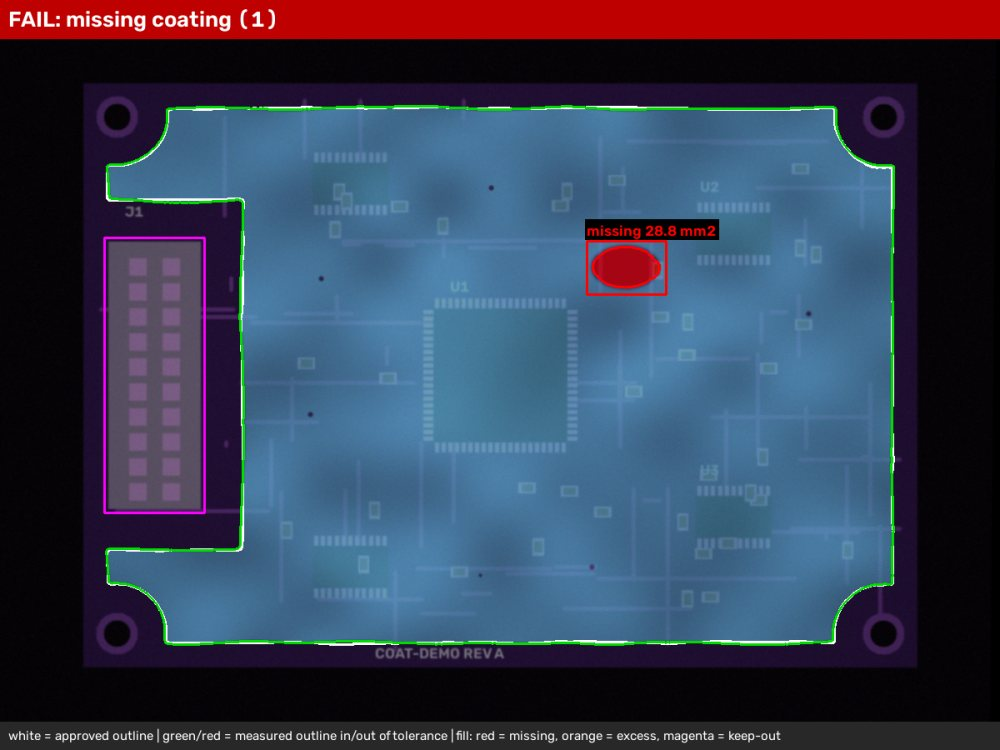

*The finished tool on a board with a skipped area. White: approved outline. Green: measured outline within tolerance. Red: missing coating.*

## Contents

- [How it works and reading the code](#how-it-works-and-reading-the-code)
- [Step 1: Install the tools](#step-1-install-the-tools)
- [Step 2: Create the project](#step-2-create-the-project)
- [Step 3: Settings and helpers](#step-3-settings-and-helpers)
- [Step 4: Sample photos](#step-4-sample-photos)
- [Step 5: Find the coating and its borders](#step-5-find-the-coating-and-its-borders)
- [Step 6: Tune the colour range](#step-6-tune-the-colour-range)
- [Step 7: Line up the photos](#step-7-line-up-the-photos)
- [Step 8: Build the golden pattern](#step-8-build-the-golden-pattern)
- [Step 9: Compare, report and check boards](#step-9-compare-report-and-check-boards)
- [Step 10: Automated tests](#step-10-automated-tests)
- [Step 11: Run and debug from VS Code](#step-11-run-and-debug-from-vs-code)
- [Step 12: Use it on your own boards](#step-12-use-it-on-your-own-boards)
- [Troubleshooting](#troubleshooting)
- [Going further](#going-further)

## How it works and reading the code

Conformal coatings carry a UV tracer. Under blue/UV light (365–405 nm) the coating glows light blue while bare board stays dark violet, so finding the coating is a question of colour. The tool works in five stages:

1. **Line up.** Find matching details (part corners, pins, text) in the photo and in an approved reference photo, then shift and rotate the photo to fit. OpenCV's ORB features and RANSAC do this.
2. **Find the coating.** Keep the pixels whose colour falls inside a tuned HSV range, then remove specks and fill pinholes.
3. **Trace the borders.** The outline of the coated area is the coating border (`cv2.findContours`).
4. **Compare.** Check the coating against the golden pattern, built from 3–5 approved boards, using a tolerance band around the approved edge.
5. **Report.** A PASS/FAIL verdict, a marked-up picture and a JSON report for each board, plus a CSV summary.

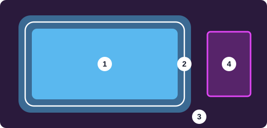

1. **Must be coated.** An uncoated area here larger than `min_defect_mm2` is *missing coating*.
2. **Tolerance band:** the approved edge (white line) ± `border_mm`. The coating edge may wander anywhere inside it.
3. **Must stay bare.** A coated area here larger than `min_defect_mm2` is *coating outside the pattern*.
4. **Keep-out zone** (connector, test point). Any coating larger than `keepout_min_mm2` is a defect.

On top of that, every point on the measured edge is compared with the approved edge. At least `min_outline_match_pct` of the points must lie within `border_mm`, which catches a coating pattern that has shifted as a whole.

> **Why not `cv2.matchShapes`?** It compares shapes regardless of position, size and rotation, so it cannot see coating that has crept 2 mm toward a connector. Once the photos are lined up, comparing positions directly is the right test.

> **No training data needed.** With controlled lighting, a tuned colour range is reliable and easy to explain in an audit. A trained model is an option for later (see [Going further](#going-further)), and it would replace only stage 2.

### The finished project

```text
coating-inspector/
├── .vscode/
│   ├── launch.json        run/debug entries for each step
│   └── settings.json      turns on the Testing panel
├── coating_inspector/
│   ├── __init__.py
│   ├── common.py          settings and image files
│   ├── synthetic.py       sample photos for testing
│   ├── segment.py         find the coating and its borders
│   ├── tune.py            slider window for the colour range
│   ├── align.py           line up photo and reference
│   ├── golden.py          build the approved pattern
│   ├── compare.py         defects, measurements, PASS/FAIL
│   ├── report.py          result picture and JSON report
│   └── check.py           check many boards at once
├── tests/
│   └── test_inspector.py
├── config.yaml            all settings
├── pytest.ini
└── requirements.txt
```

Each step adds files, runs one command and shows the output you should see. If yours matches, move on. Shortcuts are written for Windows and Linux; on macOS use <kbd>Cmd</kbd> instead of <kbd>Ctrl</kbd>.

### Reading the code

Every line of code has a plain-language explanation: a comment (the text after `#`) on the same line or on the line just above it. Every function starts with a docstring, the text in triple quotes, which says what the function does, what goes in (*Args*) and what comes out (*Returns*). Python skips comments and docstrings, so they never change what the program does.

To see the explanations in real time in VS Code:

- **Hover** over any function name, such as `segment_coating`, to see its docstring in a pop-up. This works everywhere the function is used.
- **Step through the running program**: stop it at a breakpoint and press <kbd>F10</kbd> to run one line at a time. The highlighted line is the one about to run, its comment says what it does, and the Variables panel shows the values it produces. [Step 11](#step-11-run-and-debug-from-vs-code) walks you through it.

## Step 1: Install the tools

1. **Python 3.10 or newer** from [python.org](https://www.python.org/downloads/). On Windows, tick *Add python.exe to PATH* in the installer.
2. **VS Code** from [code.visualstudio.com](https://code.visualstudio.com/).
3. In VS Code, open Extensions (<kbd>Ctrl</kbd>+<kbd>Shift</kbd>+<kbd>X</kbd>) and install **Python** by Microsoft. It installs Pylance and the Python Debugger with it.

Check Python in a terminal. Any version from 3.10 up is fine.

Windows (PowerShell):

```powershell
py --version
```

macOS / Linux:

```bash
python3 --version
```

## Step 2: Create the project

1. Create an empty folder called `coating-inspector` and open it in VS Code with *File → Open Folder*.
2. Open a terminal with *Terminal → New Terminal*. Create a virtual environment (a private set of packages for this project) and switch it on:

   Windows (PowerShell):

   ```powershell
   py -m venv .venv
   .venv\Scripts\Activate.ps1
   ```

   macOS / Linux:

   ```bash
   python3 -m venv .venv
   source .venv/bin/activate
   ```

3. The prompt now starts with `(.venv)`. Tell VS Code to use it: <kbd>Ctrl</kbd>+<kbd>Shift</kbd>+<kbd>P</kbd> → *Python: Select Interpreter* → pick the one inside `.venv`. New terminals then switch it on by themselves.
4. In the Explorer, create three folders: `coating_inspector`, `tests` and `.vscode`.

> **From here on**, run every command in this terminal, in the project folder, with `(.venv)` showing. With the environment on, `python` works on every system. If PowerShell refuses to run the activate script, see [Troubleshooting](#troubleshooting).

## Step 3: Settings and helpers

Create each file below at the path shown above it (Explorer → New File), paste the code with the copy button, and save. If you type the code yourself instead, the comments are optional: the program works the same without them.

### Packages

**File: `requirements.txt`** (5 lines)

```text
# The Python packages this project needs. Install them with:  pip install -r requirements.txt
numpy>=1.26          # NumPy: fast maths on arrays; every image is a NumPy array
opencv-python>=4.10  # OpenCV: the computer-vision library (colours, alignment, contours, drawing, windows)
PyYAML>=6.0          # PyYAML: reads the settings file config.yaml
pytest>=8.0          # pytest: runs the automated tests in tests/
```

```shell
pip install -r requirements.txt
```

```shell
python -c "import cv2, numpy, yaml; print('OpenCV', cv2.__version__)"
```

It should print OpenCV 4.10 or newer (the test run used 5.1.0).

### Settings

All settings live in one file. The values suit the sample photos; [step 12](#step-12-use-it-on-your-own-boards) explains how to set them for your boards.

**File: `config.yaml`** (29 lines)

```yaml
# Settings for the coating inspector. Every command reads this file.
# Image-processing settings are in pixels (px), pass/fail tolerances in millimetres (mm).

segmentation:              # how coating is recognised in a photo
  # Colour range of the glowing coating in HSV (OpenCV scale: H 0-179, S 0-255, V 0-255).
  # Tune it for YOUR camera and light:  python -m coating_inspector.tune --image <photo>
  hsv_lower: [85, 80, 110]     # lowest hue, saturation and brightness that still count as coating
  hsv_upper: [130, 255, 255]   # highest hue, saturation and brightness that still count as coating
  blur_px: 5               # smooth sensor noise first (0 = off)
  open_px: 2               # remove specks smaller than this radius
  close_px: 4              # fill pinholes and gaps smaller than this radius
  min_area_px: 400         # ignore glowing blobs smaller than this (dust, reflections)

alignment:                 # how each photo is lined up with the reference photo
  method: similarity       # similarity = shift + rotation, homography = also perspective, none = precise fixture
  max_features: 5000       # how many small details ORB looks for in each photo
  min_inliers: 40          # fewer matching features than this = alignment failed
  work_px: 1600            # features are found on a copy this big (speed); results are full size

golden:                    # how the approved pattern is built
  min_agreement: 0.5       # "must coat" where MORE than this share of the approved boards are coated

tolerance:                 # pass/fail rules
  pixels_per_mm: 10.0      # MEASURE this for your camera (see the guide). 10.0 matches the sample photos.
  border_mm: 1.0           # allowed wander of the coating edge from the approved edge
  min_defect_mm2: 2.0      # missing or extra coating smaller than this is ignored
  keepout_min_mm2: 0.2     # coating in a keep-out zone bigger than this is a defect
  min_coverage_pct: 99.0   # share of the must-coat area that must be coated
  min_outline_match_pct: 95.0  # share of the coating edge that must be within border_mm of the approved edge
```

**File: `pytest.ini`** (6 lines)

```ini
# Settings for pytest, the program that runs the automated tests.
[pytest]
# Let the tests import the coating_inspector package from this folder.
pythonpath = .
# Look for tests in the tests/ folder.
testpaths = tests
```

`pytest.ini` tells pytest where the code and the tests are.

### Package files

**File: `coating_inspector/__init__.py`** (5 lines)

```python
"""Conformal coating inspection under blue/UV light: find the coating borders and
compare them with an approved (golden) pattern.

This file marks the folder as a Python package, so its modules can import each other
(for example `from .common import read_image`) and can be run with `python -m`."""
```

This file marks the folder as a Python package, so the modules can import each other.

**File: `coating_inspector/common.py`** (121 lines)

```python
"""Shared helpers used by the other modules: reading the settings file and reading and
writing image files."""
from __future__ import annotations  # lets type hints such as list[Path] work on older Python versions

import glob  # finds files that match a wildcard pattern such as photos/*.png
from pathlib import Path  # Path objects handle file and folder paths the same way on every system

import cv2  # OpenCV: decodes and encodes image files
import numpy as np  # NumPy: every image is a NumPy array of numbers
import yaml  # PyYAML: reads the settings file config.yaml

# File endings that count as photos when a whole folder is given.
IMAGE_TYPES = {".png", ".jpg", ".jpeg", ".bmp", ".tif", ".tiff"}


def load_config(path="config.yaml") -> dict:
    """Read the settings file.

    Args:
        path: the YAML settings file; by default config.yaml in the current folder.

    Returns:
        The settings as nested dictionaries, for example cfg["tolerance"]["border_mm"] -> 1.0.
    """
    # Accept either a plain text path or a Path object.
    path = Path(path)
    # A missing file would cause a confusing error later, so stop here with a clear message.
    if not path.exists():
        # Stop with this message.
        raise FileNotFoundError(f"{path} not found - run from the project folder or pass --config")
    # Open the file as text ("with" closes it again automatically) ...
    with open(path, encoding="utf-8") as f:
        # ... and turn the YAML text into Python dictionaries, lists and numbers.
        return yaml.safe_load(f)


def read_image(path) -> np.ndarray:
    """Read a photo from disk.

    Unlike cv2.imread, this also works with non-English characters in Windows folder names.

    Args:
        path: the image file (PNG, JPG, BMP, TIFF ...).

    Returns:
        The photo as an array of shape (height, width, 3): blue, green and red values 0-255 per pixel.
    """
    # Read the file's raw bytes into a NumPy array (this works with any folder name).
    data = np.fromfile(str(path), dtype=np.uint8)
    # Decode those bytes into a colour image; OpenCV stores colours in BGR order, not RGB.
    image = cv2.imdecode(data, cv2.IMREAD_COLOR)
    # imdecode returns None when the bytes are not a picture it understands.
    if image is None:
        raise ValueError(f"{path} is not an image OpenCV can read")  # stop with this message
    # Hand the image back to the caller.
    return image


def read_mask(path) -> np.ndarray:
    """Read a black-and-white mask picture.

    Args:
        path: the mask file; white marks the area, black marks everything else.

    Returns:
        An array of shape (height, width): 255 where the picture is light, 0 where it is dark.
    """
    # Read the picture in colour, then convert it to one grey value per pixel.
    gray = cv2.cvtColor(read_image(path), cv2.COLOR_BGR2GRAY)
    # Light pixels (above 127) become 255, dark ones 0; uint8 is the 0-255 number type OpenCV expects.
    return np.where(gray > 127, 255, 0).astype(np.uint8)


def write_image(path, image) -> None:
    """Save an image, creating its folder if needed.

    Args:
        path: where to save it; the file ending (.png, .jpg ...) chooses the format.
        image: the image array to save.
    """
    # Accept either a plain text path or a Path object.
    path = Path(path)
    # Create the folder and any missing parent folders; no error if it already exists.
    path.parent.mkdir(parents=True, exist_ok=True)
    # Encode the image into file bytes, in the format given by the file ending (PNG if there is none).
    ok, data = cv2.imencode(path.suffix or ".png", image)
    # imencode returns ok = False if it could not encode the image.
    if not ok:
        raise ValueError(f"could not save {path}")  # stop with this message
    # Write the bytes to disk (this works with any folder name, like read_image).
    data.tofile(str(path))


def find_images(items) -> list[Path]:
    """Turn a list of files, folders and wildcards into a list of image files.

    Windows terminals pass *.png to Python without expanding it, so wildcards are expanded here.

    Args:
        items: file paths, folder paths and/or patterns such as photos/*.png.

    Returns:
        The image files as Path objects, sorted by name within each folder or pattern.
    """
    # Start with an empty list and add to it for each item.
    paths = []
    # Look at each item the user typed.
    for item in items:
        # Make a Path object, so we can ask whether it is a folder.
        p = Path(item)
        # A folder: take every file in it with a known image ending, sorted by name.
        if p.is_dir():
            paths += sorted(f for f in p.iterdir() if f.suffix.lower() in IMAGE_TYPES)  # add them to the list
        # A wildcard pattern (it contains *, ? or [): let glob find the matching files.
        elif any(ch in str(item) for ch in "*?["):
            paths += sorted(Path(f) for f in glob.glob(str(item)))  # add the matches, sorted by name
        # Anything else is a single file: use it as it is.
        else:
            paths.append(p)  # add the single file
    # Hand the complete list back.
    return paths
```

Images are read with `np.fromfile` and `cv2.imdecode` because `cv2.imread` fails on Windows paths with non-English characters. `find_images` accepts files, folders and wildcards, because Windows terminals pass `*.png` to Python without expanding it.

Optional, if you keep the project in git:

**File: `.gitignore`** (13 lines)

```text
# Files git should not store, because they are made on your computer and can be made again.
# The virtual environment (the installed packages):
.venv/
# Python's caches of compiled code:
__pycache__/
# pytest's cache:
.pytest_cache/
# Pictures from the quick checks in segment.py and align.py:
out/
# Result pictures and reports from check.py:
results/
# The synthetic sample photos (python -m coating_inspector.synthetic makes them again):
samples/
```

## Step 4: Sample photos

Every step needs photos to try out, so this module draws a realistic board under UV light: three approved boards and six test boards. Each board sits slightly shifted and rotated in the "fixture", the coating edge wanders a little as it does on real boards, and four test boards carry a known defect. It also writes the keep-out mask for connector J1, and `truth.json` with each board's exact placement.

**File: `coating_inspector/synthetic.py`** (329 lines)

```python
"""Step 4: make synthetic photos of a coated board under blue/UV light, so every step can be
run and checked before you have real photos.   Run:  python -m coating_inspector.synthetic

The photos are drawn, not photographed: the board layout is drawn, the glowing coating is
blended on top, the board is shifted and rotated as if placed in a fixture, and lamp
fall-off, lens blur and sensor noise are added."""
from __future__ import annotations  # lets the type hint "str | None" work on older Python versions

import json  # writes truth.json (the exact placement of each sample board)
from pathlib import Path  # handles file and folder paths
from typing import NamedTuple  # NamedTuple: a small record type with named fields

import cv2  # OpenCV: drawing shapes, blurring, warping
import numpy as np  # NumPy: images as arrays, random numbers

from .common import write_image  # our helper that saves an image and creates its folder

PX_PER_MM = 10                      # drawing scale: 10 pixels per millimetre (same as config.yaml)
WIDTH, HEIGHT = 1200, 900           # photo size in pixels
BOARD_MM = (100, 70)                # board size in mm (width, height)
ORIGIN = (100, 100)                 # where the board's top-left corner sits in the photo, in pixels
HOLES_MM = [(4, 4), (96, 4), (4, 66), (96, 66)]  # centres of the four mounting holes, in mm

# Colours as a camera sees them under UV/blue light without a filter. OpenCV order is (blue, green, red).
BACKGROUND = (12, 6, 10)            # almost black: the space around the board
SOLDER_MASK = (75, 22, 48)          # dark violet: bare board under UV light
COPPER = (140, 55, 105)             # brighter violet: copper reflects the light
IC_BODY = (28, 16, 22)              # near black: plastic chip packages
PIN = (200, 140, 185)               # pale violet: shiny pins and solder pads
PART_BODY = (60, 70, 90)            # dull brown-grey: resistor and capacitor bodies
SILKSCREEN = (190, 172, 176)        # whitish: printed labels glow a little but are not saturated blue
CONNECTOR = (150, 122, 136)         # grey-violet: the plastic housing of connector J1
GLOW = (255, 205, 110)              # light blue: the coating's UV tracer glowing


class Sample(NamedTuple):
    """How one sample photo is made."""
    folder: str                     # sub-folder of samples/: "approved" or "test"
    seed: int                       # random-number seed, so the same photo is made every time
    angle: float                    # rotation in the fixture, degrees counter-clockwise
    shift: tuple                    # shift in the fixture, (x, y) in pixels
    defect: str | None              # which defect to draw, or None for a good board


# The nine sample photos: name -> how to make it.
SAMPLES = {
    "approved_1": Sample("approved", 1, 0.0, (0, 0), None),     # the reference: placed exactly
    "approved_2": Sample("approved", 2, 0.8, (12, -7), None),   # approved, slightly shifted and turned
    "approved_3": Sample("approved", 3, -0.6, (-9, 10), None),  # approved, shifted and turned the other way
    "good_1": Sample("test", 4, 1.3, (18, 9), None),            # good board: should PASS
    "good_2": Sample("test", 5, -1.1, (-15, -12), None),        # good board: should PASS
    "missing_coating": Sample("test", 6, 0.5, (8, 14), "missing_coating"),        # a patch without coating
    "excess_spill": Sample("test", 7, -0.9, (-11, 6), "excess_spill"),            # coating runs toward J1
    "keepout_violation": Sample("test", 8, 1.0, (14, -10), "keepout_violation"),  # coating on connector J1
    "shifted_pattern": Sample("test", 9, -0.4, (6, 8), "shifted_pattern"),        # whole pattern 2.5 mm off
}


def P(x_mm, y_mm):
    """Convert a position on the board in mm into a pixel position in the photo.

    Args:
        x_mm, y_mm: distance from the board's top-left corner, in mm.

    Returns:
        (x, y) in whole pixels, which is what OpenCV's drawing functions need.
    """
    # Scale mm to pixels, add the board's offset in the photo, and round to whole pixels.
    return int(round(ORIGIN[0] + x_mm * PX_PER_MM)), int(round(ORIGIN[1] + y_mm * PX_PER_MM))


def design_masks():
    """Draw the coating drawing: where coating must go, and the keep-out zone (connector J1).

    Returns:
        (coat, keepout): two masks the size of the photo, 255 inside the area and 0 outside.
    """
    # Start with an all-black (0) picture: nothing is coated yet.
    coat = np.zeros((HEIGHT, WIDTH), np.uint8)
    # Coat the whole board except a 3 mm margin along every edge (thickness -1 = filled).
    cv2.rectangle(coat, P(3, 3), P(97, 67), 255, -1)
    # Leave a clear area around connector J1 by painting it back to 0.
    cv2.rectangle(coat, P(0, 14), P(19, 56), 0, -1)
    # Leave a clear circle of radius 6 mm around each mounting hole.
    for hole in HOLES_MM:
        cv2.circle(coat, P(*hole), 6 * PX_PER_MM, 0, -1)  # a filled black circle
    # The keep-out mask starts black too, the same size as the coating mask.
    keepout = np.zeros_like(coat)
    # Mark connector J1 itself (plus 0.5 mm) as a zone that must never be coated.
    cv2.rectangle(keepout, P(2.5, 18.5), P(14.5, 51.5), 255, -1)
    # Return both masks.
    return coat, keepout


def _chip(img, centre, size, pins_on_all_sides):
    """Draw a chip: a black body with pins sticking out.

    Args:
        img: the picture to draw on (changed in place).
        centre: (x, y) of the chip's centre, in mm.
        size: (width, height) of the chip body, in mm.
        pins_on_all_sides: True for pins on all four sides, False for top and bottom only.
    """
    # Unpack the centre and the size into four separate numbers.
    (cx, cy), (w, h) = centre, size
    # How many pins fit along the width at a 0.8 mm pitch.
    n = int(w / 0.8)
    # Draw the pins along the top and bottom edges.
    for i in range(n):
        # x position of pin i, spaced evenly across the chip's width.
        x = cx - w / 2 + (i + 0.5) * w / n
        # A thin bar from above the chip to below it; the body drawn last hides its middle,
        # so only the two ends stay visible as pins.
        cv2.rectangle(img, P(x - 0.2, cy - h / 2 - 1.2), P(x + 0.2, cy + h / 2 + 1.2), PIN, -1)
    # Draw pins on the left and right edges too, if asked.
    if pins_on_all_sides:
        # How many pins fit along the height.
        m = int(h / 0.8)
        # Same trick as above, with horizontal bars.
        for i in range(m):
            # y position of pin i, spaced evenly down the chip's height.
            y = cy - h / 2 + (i + 0.5) * h / m
            # A thin horizontal bar across the chip; its two ends become the pins.
            cv2.rectangle(img, P(cx - w / 2 - 1.2, y - 0.2), P(cx + w / 2 + 1.2, y + 0.2), PIN, -1)
    # Finally the black body on top, which hides the middle of every bar.
    cv2.rectangle(img, P(cx - w / 2, cy - h / 2), P(cx + w / 2, cy + h / 2), IC_BODY, -1)


def _draw_board(img):
    """Draw the board layout, the same on every photo.

    Args:
        img: the picture to draw on (changed in place).
    """
    # A fixed seed makes the "random" traces and parts identical on every photo.
    rng = np.random.default_rng(7)
    # The board itself: a filled dark-violet rectangle.
    cv2.rectangle(img, P(0, 0), P(*BOARD_MM), SOLDER_MASK, -1)
    # 70 copper traces.
    for _ in range(70):
        # A random starting point on the board, in mm.
        x, y = rng.uniform(16, 96), rng.uniform(4, 66)
        # Half of the traces run sideways ...
        if rng.random() < 0.5:
            # ... up to 25 mm left or right; np.clip keeps the end on the board.
            end = (float(np.clip(x + rng.uniform(-25, 25), 2, 98)), y)
        # ... and the other half run up or down.
        else:
            # ... up to 20 mm, also kept on the board.
            end = (x, float(np.clip(y + rng.uniform(-20, 20), 2, 68)))
        # Draw the trace 3 pixels (0.3 mm) wide.
        cv2.line(img, P(x, y), P(*end), COPPER, 3)
    # The big chip U1 in the middle, with pins on all four sides.
    _chip(img, (50, 35), (16, 16), pins_on_all_sides=True)
    # Four smaller chips with pins on two sides.
    for centre in [(78, 18), (78, 52), (32, 58), (32, 12)]:
        _chip(img, centre, (9, 5), pins_on_all_sides=False)  # 9 x 5 mm, pins on two sides
    # 45 attempts at placing small resistors and capacitors.
    for _ in range(45):
        # A random position, in mm.
        x, y = rng.uniform(22, 92), rng.uniform(8, 62)
        # Skip positions on top of U1.
        if abs(x - 50) < 12 and abs(y - 35) < 12:
            continue  # skip to the next attempt
        # Half lie horizontally (2 x 1.25 mm), half vertically (1.25 x 2 mm).
        w, h = (2.0, 1.25) if rng.random() < 0.5 else (1.25, 2.0)
        # The solder pads: a shiny rectangle the full size of the part ...
        cv2.rectangle(img, P(x - w / 2, y - h / 2), P(x + w / 2, y + h / 2), PIN, -1)
        # ... with the smaller body on top, so the pads show at both ends.
        cv2.rectangle(img, P(x - w / 3, y - h / 3), P(x + w / 3, y + h / 3), PART_BODY, -1)
    # Printed labels (silkscreen): each text and its position in mm.
    for text, pos in [("U1", (44, 25)), ("U2", (74, 13)), ("U3", (74, 47)), ("J1", (5, 16)),
                      ("COAT-DEMO REV A", (35, 69))]:
        # Draw the text; LINE_AA smooths its edges.
        cv2.putText(img, text, P(*pos), cv2.FONT_HERSHEY_SIMPLEX, 0.6, SILKSCREEN, 2, cv2.LINE_AA)
    # Connector J1's plastic housing on the left.
    cv2.rectangle(img, P(3, 19), P(14, 51), CONNECTOR, -1)
    # Its 10 rows ...
    for row in range(10):
        # ... of 2 pins.
        for col in range(2):
            # One 2 x 2 mm pin, on a grid 4 mm apart sideways and 3 mm apart downwards.
            cv2.rectangle(img, P(5.5 + 4 * col, 21 + 3 * row), P(7.5 + 4 * col, 23 + 3 * row), PIN, -1)
    # The four mounting holes.
    for hole in HOLES_MM:
        # A copper ring of radius 25 px (2.5 mm) ...
        cv2.circle(img, P(*hole), 25, COPPER, -1)
        # ... with the drilled hole (radius 1.6 mm) showing the dark background.
        cv2.circle(img, P(*hole), 16, BACKGROUND, -1)


def _smooth_noise(rng, cell_px):
    """Make a smooth random pattern, used for the wandering coating edge and its thickness.

    Args:
        rng: the random-number generator.
        cell_px: roughly how many pixels it takes for the pattern to change.

    Returns:
        A decimal array the size of the photo with values from -1 to 1.
    """
    # A small grid of random numbers between -1 and 1 (one per cell, plus a spare row and column).
    small = rng.uniform(-1, 1, (HEIGHT // cell_px + 2, WIDTH // cell_px + 2)).astype(np.float32)
    # Enlarge it to the photo size with smooth (cubic) interpolation, and keep the values in -1..1.
    return np.clip(cv2.resize(small, (WIDTH, HEIGHT), interpolation=cv2.INTER_CUBIC), -1, 1)


def _soft_ellipse(centre_mm, axes_mm):
    """Make an ellipse with a blurry edge, used to draw the defects.

    Args:
        centre_mm: (x, y) centre, in mm.
        axes_mm: (half-width, half-height), in mm.

    Returns:
        A decimal array the size of the photo: 1 inside the ellipse, 0 outside, soft in between.
    """
    # Start with an all-zero picture of decimal numbers.
    blob = np.zeros((HEIGHT, WIDTH), np.float32)
    # Convert the ellipse's half-width and half-height from mm to pixels.
    axes = (int(axes_mm[0] * PX_PER_MM), int(axes_mm[1] * PX_PER_MM))
    # Draw a filled ellipse with value 1.0 (not rotated, from 0 to 360 degrees, thickness -1 = filled).
    cv2.ellipse(blob, P(*centre_mm), axes, 0, 0, 360, 1.0, -1)
    # Blur it so the edge fades out over a few pixels, like real coating.
    return cv2.GaussianBlur(blob, (0, 0), 2)


def render_board(sample: Sample) -> np.ndarray:
    """Make one synthetic photo.

    Args:
        sample: how to make it (random seed, placement, defect).

    Returns:
        The photo: an array of shape (900, 1200, 3) with BGR values 0-255.
    """
    # Each sample has its own seed, so its edge, bubbles and noise differ but are repeatable.
    rng = np.random.default_rng(sample.seed)
    # An 8-bit colour picture filled with the background colour.
    board = np.full((HEIGHT, WIDTH, 3), BACKGROUND, np.uint8)
    # Draw the board layout onto it.
    _draw_board(board)
    # Switch to decimal numbers, so the blending maths below doesn't round off.
    img = board.astype(np.float32)

    # Get the coating drawing (the keep-out mask is not needed here, hence the _).
    coat, _ = design_masks()
    # For the shifted-pattern defect, move the whole coating 25 px (2.5 mm) to the right.
    if sample.defect == "shifted_pattern":
        coat = np.roll(coat, 25, axis=1)  # axis=1 = sideways
    # Signed distance to the coating edge in px: positive inside the coating, negative outside.
    # (distanceTransform gives each pixel's distance to the nearest black pixel.)
    edge = cv2.distanceTransform(coat, cv2.DIST_L2, 5) - cv2.distanceTransform(255 - coat, cv2.DIST_L2, 5)
    # Make the edge wander by up to 3 px (0.3 mm) either way, like a real spray edge.
    edge += 3.0 * _smooth_noise(rng, 60)
    # Coating strength from 0 to 1: 1 well inside, 0 outside, fading over about 3 px at the edge.
    alpha = np.clip(0.5 + edge / 3.0, 0, 1)
    # Missing-coating defect: remove the coating inside an 8 x 5 mm ellipse.
    if sample.defect == "missing_coating":
        alpha *= 1 - _soft_ellipse((65, 22), (4, 2.5))  # 1 - ellipse is 0 inside it, so the coating there goes
    # Excess defect: add a blob of coating that runs from the edge toward connector J1.
    if sample.defect == "excess_spill":
        alpha = np.maximum(alpha, _soft_ellipse((18, 33), (2.5, 3.5)))  # keep the larger value: coating plus blob
    # Keep-out defect: add a drop of coating on connector J1.
    if sample.defect == "keepout_violation":
        alpha = np.maximum(alpha, _soft_ellipse((8.5, 40), (2, 1.5)))  # keep the larger value: coating plus drop
    # Find all pixels more than 15 px inside the coating ...
    ys, xs = np.nonzero(edge > 15)
    # ... and put a tiny thin spot (a bubble) at 6 of them, chosen at random. They are too small to fail.
    for i in rng.choice(len(xs), 6, replace=False):
        # A filled circle of radius 2-3 px where the coating is only 20 % strong.
        cv2.circle(alpha, (int(xs[i]), int(ys[i])), int(rng.integers(2, 4)), 0.2, -1)
    # The coating thickness varies smoothly between 0.7 and 1.0.
    thickness = 0.85 + 0.15 * _smooth_noise(rng, 80)
    # Add a third axis, so alpha can multiply all three colour channels at once.
    a = alpha[..., None]
    # Blend: where coated, the board shows through darker (the coating is clear) and the blue glow is added.
    img = img * (1 - 0.7 * a) + np.array(GLOW, np.float32) * (0.9 * thickness[..., None]) * a

    # Where the board sits in the fixture: a rotation about the photo centre ...
    m = cv2.getRotationMatrix2D((WIDTH / 2, HEIGHT / 2), sample.angle, 1.0)
    # ... plus a shift, added to the matrix's last column.
    m[:, 2] += sample.shift
    # Move the picture accordingly; uncovered corners get the background colour.
    img = cv2.warpAffine(img, m, (WIDTH, HEIGHT), flags=cv2.INTER_LINEAR, borderValue=BACKGROUND)
    # Coordinate grids: yy holds each pixel's row number, xx its column number.
    yy, xx = np.mgrid[0:HEIGHT, 0:WIDTH]
    # Squared distance from the photo centre, scaled to 0 at the centre and 1 in the corners.
    r2 = ((xx - WIDTH / 2) ** 2 + (yy - HEIGHT / 2) ** 2) / ((WIDTH / 2) ** 2 + (HEIGHT / 2) ** 2)
    # Lamp fall-off: up to 22 % darker in the corners.
    img *= (1 - 0.22 * r2).astype(np.float32)[..., None]
    # Lens blur: a slight Gaussian blur.
    img = cv2.GaussianBlur(img, (0, 0), 0.8)
    # Sensor noise: random variation with a standard deviation of 4 brightness levels.
    img += rng.normal(0, 4, img.shape).astype(np.float32)
    # Keep the values within 0..255 and convert back to the 8-bit image type.
    return np.clip(img, 0, 255).astype(np.uint8)


def make_samples(out_dir="samples") -> Path:
    """Make all sample photos, the keep-out mask and truth.json.

    Args:
        out_dir: the folder to write them to.

    Returns:
        The folder, as a Path.
    """
    # Accept a plain text path or a Path object.
    out = Path(out_dir)
    # Make and save each of the nine photos in its sub-folder (approved/ or test/).
    for name, sample in SAMPLES.items():
        write_image(out / sample.folder / f"{name}.png", render_board(sample))  # for example samples/test/good_1.png
    # Save the keep-out mask (the second mask returned by design_masks).
    write_image(out / "keepout_mask.png", design_masks()[1])
    # Record each photo's settings (placement, defect), so the alignment can be checked against them.
    truth = {name: sample._asdict() for name, sample in SAMPLES.items()}
    # Write that record as readable JSON text.
    (out / "truth.json").write_text(json.dumps(truth, indent=2), encoding="utf-8")
    # Tell the caller where everything went.
    return out


# This block runs only when the file is started with  python -m coating_inspector.synthetic
if __name__ == "__main__":
    # Make the samples in the default folder, samples/.
    folder = make_samples()
    # Report what was made.
    print(f"made {len(SAMPLES)} photos in {folder}/approved and {folder}/test, plus {folder}/keepout_mask.png")
```

```shell
python -m coating_inspector.synthetic
```

**Expected output**

```text
made 9 photos in samples/approved and samples/test, plus samples/keepout_mask.png
```

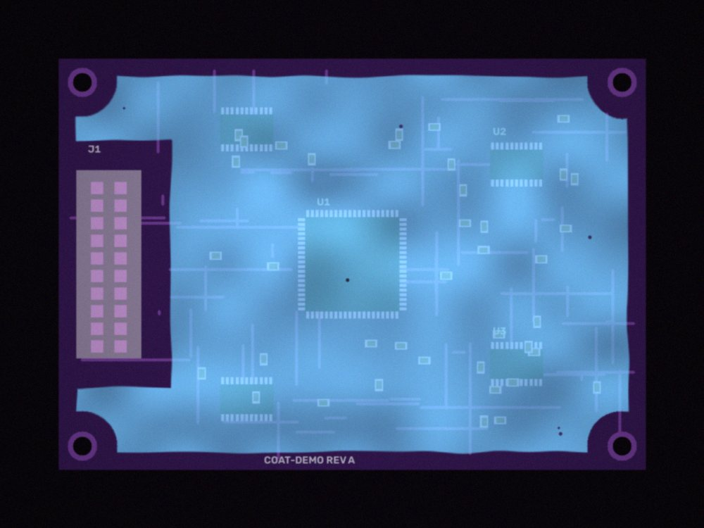

*`samples/approved/approved_1.png`. Click any PNG in the VS Code Explorer to view it.*

| Test photo | What it shows | Expected |
|---|---|---|
| `good_1`, `good_2` | Normal boards, placed differently | **PASS** |
| `missing_coating` | An 8 × 5 mm area the spray skipped | **FAIL**: missing |
| `excess_spill` | Coating running toward connector J1 | **FAIL**: outside pattern |
| `keepout_violation` | A drop of coating on J1 | **FAIL**: keep-out |
| `shifted_pattern` | The whole pattern 2.5 mm to the right | **FAIL**: missing, outside, outline |

## Step 5: Find the coating and its borders

HSV splits a colour into hue (H, which colour), saturation (S, how strong) and value (V, how bright). OpenCV's H runs from 0 to 179, so blue sits around 120. Measured on the sample photos:

- glowing coating: H ≈ 100, S ≈ 135, V ≈ 210, inside the range;
- bare board: H ≈ 136, V ≈ 75, too violet and too dark;
- copper reflections: violet, outside the H range;
- white silkscreen: bright, but S ≈ 25 is not saturated enough.

After the colour test, *opening* removes specks, *closing* fills pinholes, and blobs below `min_area_px` are dropped. `find_borders` returns the outlines: the outer edges plus the edges of any holes.

**File: `coating_inspector/segment.py`** (117 lines)

```python
"""Step 5: find the glowing coating and trace its borders.
Quick check:  python -m coating_inspector.segment samples/approved/approved_1.png"""
from __future__ import annotations  # lets newer type hints work on older Python versions

import sys  # sys.argv holds the words typed after the command; sys.exit stops the program

import cv2  # OpenCV: colour conversion, colour thresholds, morphology, contours
import numpy as np  # NumPy: images as arrays

from .common import load_config, read_image, write_image  # our settings and image-file helpers


def disk(radius: int) -> np.ndarray:
    """Make a round "brush" for the morphology operations (open, close, erode, dilate).

    Args:
        radius: brush radius in pixels.

    Returns:
        A (2*radius+1) x (2*radius+1) array with 1s in a filled circle.
    """
    # OpenCV builds the circle-shaped brush (MORPH_ELLIPSE) in the requested size.
    return cv2.getStructuringElement(cv2.MORPH_ELLIPSE, (2 * radius + 1, 2 * radius + 1))


def segment_coating(image: np.ndarray, seg: dict) -> np.ndarray:
    """Find the coated pixels in a photo.

    Args:
        image: the photo, BGR, shape (height, width, 3).
        seg: the "segmentation" section of config.yaml.

    Returns:
        A mask of shape (height, width): 255 where there is coating, 0 elsewhere.
    """
    # Smooth the sensor noise first, if blur_px is more than 1.
    if seg["blur_px"] > 1:
        # GaussianBlur needs an odd kernel size: 4 -> 5, 5 -> 5, 6 -> 7.
        k = seg["blur_px"] // 2 * 2 + 1
        # Average each pixel with its neighbours, weighted like a bell curve.
        image = cv2.GaussianBlur(image, (k, k), 0)
    # Convert BGR to HSV: hue (which colour), saturation (how strong), value (how bright).
    hsv = cv2.cvtColor(image, cv2.COLOR_BGR2HSV)
    # Keep the pixels whose H, S and V are all inside the range: 255 = inside (coating), 0 = outside.
    mask = cv2.inRange(hsv, np.array(seg["hsv_lower"], np.uint8), np.array(seg["hsv_upper"], np.uint8))
    # Opening (shrink, then grow back) removes specks smaller than the brush.
    if seg["open_px"] > 0:
        # Apply it with a round brush of radius open_px.
        mask = cv2.morphologyEx(mask, cv2.MORPH_OPEN, disk(seg["open_px"]))
    # Closing (grow, then shrink back) fills pinholes and gaps smaller than the brush.
    if seg["close_px"] > 0:
        # Apply it with a round brush of radius close_px.
        mask = cv2.morphologyEx(mask, cv2.MORPH_CLOSE, disk(seg["close_px"]))
    # Finally drop any remaining blobs that are too small to be coating.
    return remove_small_blobs(mask, seg["min_area_px"])


def remove_small_blobs(mask: np.ndarray, min_area_px: int) -> np.ndarray:
    """Delete separate white areas smaller than min_area_px.

    Args:
        mask: a 0/255 mask.
        min_area_px: the smallest area to keep, in pixels.

    Returns:
        A new 0/255 mask without the small areas.
    """
    # Give every separate white area its own number (label) and measure it; stats holds the areas.
    count, labels, stats, _ = cv2.connectedComponentsWithStats(mask, connectivity=8)
    # For each label: True if its area is big enough.
    keep = stats[:, cv2.CC_STAT_AREA] >= min_area_px
    # Label 0 is the black background, which is never kept.
    keep[0] = False
    # Look up every pixel's label in "keep": kept areas become 255, everything else 0.
    return np.where(keep[labels], 255, 0).astype(np.uint8)


def find_borders(mask: np.ndarray) -> list:
    """Trace the outlines of the coated areas.

    Args:
        mask: a 0/255 mask.

    Returns:
        A list of contours (outer edges and the edges of holes); each is an array of (x, y) points.
    """
    # RETR_LIST returns every outline, including hole edges; CHAIN_APPROX_NONE keeps every edge pixel.
    contours, _ = cv2.findContours(mask, cv2.RETR_LIST, cv2.CHAIN_APPROX_NONE)
    # Return a plain Python list (newer OpenCV versions return a tuple).
    return list(contours)


# This block runs only when the file is started with  python -m coating_inspector.segment <photo>
if __name__ == "__main__":
    # Exactly one photo must be given after the command.
    if len(sys.argv) != 2:
        sys.exit("usage: python -m coating_inspector.segment <photo>")  # otherwise show how to use it and stop
    # Read the settings ...
    cfg = load_config()
    # ... and the photo named after the command.
    image = read_image(sys.argv[1])
    # Find the coating ...
    mask = segment_coating(image, cfg["segmentation"])
    # ... and its borders.
    borders = find_borders(mask)
    # Draw on a copy, so the original photo stays unchanged.
    preview = image.copy()
    # Draw all the borders (-1 = every contour) in yellow (BGR 0, 255, 255), 2 px thick.
    cv2.drawContours(preview, borders, -1, (0, 255, 255), 2)
    # Save the mask and the preview, so you can look at them.
    write_image("out/mask.png", mask)  # the black/white coating mask
    write_image("out/borders.png", preview)  # the photo with the borders drawn on it
    # Pixels per mm, to convert the coated pixel count into mm2.
    ppm = cfg["tolerance"]["pixels_per_mm"]
    # Report the coated area and the number of outlines.
    print(f"coated area: {cv2.countNonZero(mask) / ppm**2:.0f} mm2 in {len(borders)} outline(s)")
    print("saved out/mask.png and out/borders.png")  # tell the user where the pictures are
```

```shell
python -m coating_inspector.segment samples/approved/approved_1.png
```

**Expected output**

```text
coated area: 5208 mm2 in 1 outline(s)
saved out/mask.png and out/borders.png
```

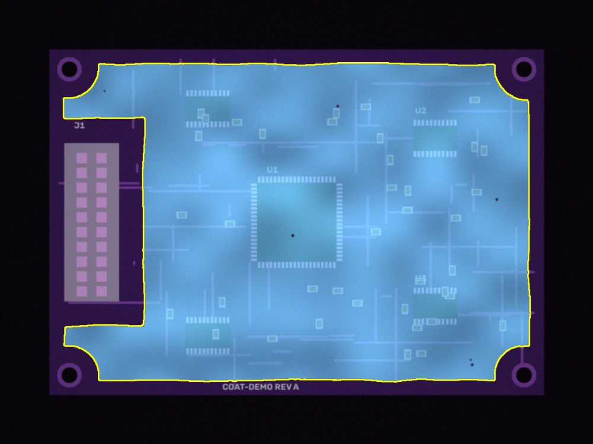

*`out/borders.png`: the detected coating border in yellow.*

## Step 6: Tune the colour range

Your camera and light will produce different colours from the samples. This tool shows the effect of the colour range live while you move sliders.

**File: `coating_inspector/tune.py`** (201 lines)

```python
"""Step 6: tune the coating colour range on YOUR photos with sliders.
Run:  python -m coating_inspector.tune --image samples/approved/approved_1.png
Click the photo to print a pixel's HSV value (and its distance from the previous click, for calibration).
Keys:  s = save the sliders to config.yaml,  q or Esc = quit."""
from __future__ import annotations  # lets newer type hints work on older Python versions

import argparse  # reads the options typed after the command (--image, --config)
import math  # math.dist: the distance between two points
import re  # regular expressions: find and replace the values inside config.yaml
from pathlib import Path  # handles file paths

import cv2  # OpenCV: windows, sliders, mouse clicks, drawing
import numpy as np  # NumPy: images as arrays

from .common import load_config, read_image  # settings and image-file helpers
from .segment import find_borders, segment_coating  # the same coating detection the inspection uses

SLIDERS_WINDOW = "coating tuner - sliders"  # title of the window with the sliders
PHOTO_WINDOW = "coating tuner - photo"  # title of the window with the photo
SLIDERS = [  # (label, config key, list index or None, maximum)
    ("H min", "hsv_lower", 0, 179), ("H max", "hsv_upper", 0, 179),  # hue limits (OpenCV hue runs 0-179)
    ("S min", "hsv_lower", 1, 255), ("S max", "hsv_upper", 1, 255),  # saturation limits
    ("V min", "hsv_lower", 2, 255), ("V max", "hsv_upper", 2, 255),  # brightness limits
    ("blur", "blur_px", None, 15), ("open", "open_px", None, 10), ("close", "close_px", None, 15),  # clean-up
]


def save_to_config(path, seg: dict) -> None:
    """Write the slider values into config.yaml, keeping all its comments.

    Only the numbers are replaced, so the file keeps its layout and explanations.

    Args:
        path: the settings file to update.
        seg: the segmentation settings with the new values.
    """
    # Read the whole settings file as text.
    text = Path(path).read_text(encoding="utf-8")
    # The two colour limits are lists such as [85, 80, 110].
    for key in ("hsv_lower", "hsv_upper"):
        # Make sure they are plain whole numbers.
        values = [int(v) for v in seg[key]]
        # Replace the [...] after "hsv_lower:" with the new list; \g<1> keeps the "hsv_lower: " part.
        text = re.sub(rf"^(\s*{key}:\s*)\[[^\]]*\]", rf"\g<1>{values}", text, flags=re.M)
    # The three clean-up settings are single numbers.
    for key in ("blur_px", "open_px", "close_px"):
        # Replace the number after "blur_px:" (and so on) with the new value.
        text = re.sub(rf"^(\s*{key}:\s*)\d+", rf"\g<1>{int(seg[key])}", text, flags=re.M)
    # Save the updated text back to the file.
    Path(path).write_text(text, encoding="utf-8")


def preview(image, mask, scale):
    """Make the picture shown in the photo window.

    Args:
        image: the full-size photo.
        mask: the coating found in it (0/255).
        scale: how much to shrink the picture to fit on the screen (1.0 = full size).

    Returns:
        The shrunken photo with the coating tinted green and its border drawn in yellow.
    """
    # Work on a copy, so the original photo stays unchanged.
    view = image.copy()
    # Coated pixels become half their own colour plus some green, so the coating looks tinted green.
    view[mask > 0] = (0.5 * view[mask > 0] + (0, 128, 0)).astype(np.uint8)
    # Draw the coating border in yellow, thick enough to stay visible after shrinking.
    cv2.drawContours(view, find_borders(mask), -1, (0, 255, 255), max(1, round(1.5 / scale)))
    # Shrink the picture to fit the screen; INTER_AREA gives the cleanest result when shrinking.
    return cv2.resize(view, None, fx=scale, fy=scale, interpolation=cv2.INTER_AREA)


def help_picture():
    """Make the small instructions picture shown in the sliders window.

    Returns:
        A dark-grey image with two lines of white text.
    """
    # A 64 x 520 pixel dark-grey picture.
    picture = np.full((64, 520, 3), 45, np.uint8)
    # Write each instruction line, 28 px below the previous one.
    for row, text in enumerate(["Move the sliders until only the coating is green.",
                                "Click photo = print HSV    s = save to config    q = quit"]):
        # White text, size 0.55, 1 px thick, with smoothed edges.
        cv2.putText(picture, text, (10, 24 + 28 * row), cv2.FONT_HERSHEY_SIMPLEX, 0.55, (255, 255, 255), 1,
                    cv2.LINE_AA)
    # Hand the finished picture back.
    return picture


def main(argv=None) -> int:
    """Open the tuner windows and run until the user quits.

    Args:
        argv: the command-line words; None means "use the ones typed in the terminal".

    Returns:
        0, the exit code for success.
    """
    # Describe the options this command accepts.
    ap = argparse.ArgumentParser(description="Tune the coating colour range with sliders.")
    # --image: the photo to tune on (required).
    ap.add_argument("--image", required=True, help="a photo of a coated board")
    ap.add_argument("--config", default="config.yaml")  # --config: the settings file to read and save
    # Read the options the user typed (argparse stops with a help message if --image is missing).
    args = ap.parse_args(argv)
    # Load the current segmentation settings; the sliders start at these values.
    seg = load_config(args.config)["segmentation"]
    # Load the photo.
    image = read_image(args.image)
    # Convert it to HSV once, for the click read-out.
    hsv = cv2.cvtColor(image, cv2.COLOR_BGR2HSV)
    # Shrink factor, so the photo fits in about 1000 x 700 pixels on screen (never enlarged).
    scale = min(1.0, 1000 / image.shape[1], 700 / image.shape[0])

    # Sliders and photo get separate windows, so the sliders never squeeze the photo.
    cv2.namedWindow(SLIDERS_WINDOW, cv2.WINDOW_AUTOSIZE)  # AUTOSIZE: the window fits its picture
    cv2.namedWindow(PHOTO_WINDOW, cv2.WINDOW_AUTOSIZE)  # AUTOSIZE: the window fits its picture
    # Put the sliders at the top left of the screen and the photo to their right.
    cv2.moveWindow(SLIDERS_WINDOW, 0, 0)  # top-left corner of the screen
    cv2.moveWindow(PHOTO_WINDOW, 540, 0)  # 540 px from the left, at the top
    # Create one slider per entry in SLIDERS.
    for label, key, i, top in SLIDERS:
        # Its start value: one number of a list (hsv_lower[0] ...) or a single setting (blur_px ...).
        value = seg[key][i] if i is not None else seg[key]
        # The slider runs from 0 to "top"; the empty function means "do nothing when it moves",
        # because the loop below reads all sliders anyway.
        cv2.createTrackbar(label, SLIDERS_WINDOW, int(value), top, lambda _: None)
    # Show the instructions in the sliders window.
    cv2.imshow(SLIDERS_WINDOW, help_picture())

    # Remembers the previous click for the distance read-out (a list, so on_click can change it).
    last_click = []

    def on_click(event, x, y, flags, param):
        """Called by OpenCV for every mouse event in the photo window; reacts to left clicks only."""
        # Ignore mouse moves, right clicks and so on.
        if event != cv2.EVENT_LBUTTONDOWN:
            return  # nothing to do
        # Convert the click position from the shrunken picture back to full-size photo pixels.
        px = min(int(x / scale), image.shape[1] - 1)  # the column (x); min() keeps it inside the photo
        py = min(int(y / scale), image.shape[0] - 1)  # the row (y), the same way
        # Read that pixel's hue, saturation and value (NumPy indexes images as [row, column]).
        h, s, v = (int(c) for c in hsv[py, px])
        # Build the message to print.
        message = f"pixel ({px}, {py})  HSV = ({h}, {s}, {v})"
        # After the first click, also give the distance from the previous click (for pixels_per_mm).
        if last_click:
            # Add the straight-line distance between the two clicks.
            message += f"   distance from previous click: {math.dist(last_click, (px, py)):.1f} px"
        # Remember this click for next time.
        last_click[:] = [px, py]
        # Print straight away (flush), so it appears in the terminal immediately.
        print(message, flush=True)

    # Tell OpenCV to call on_click for mouse events in the photo window.
    cv2.setMouseCallback(PHOTO_WINDOW, on_click)
    # The slider values drawn last time; None forces the first drawing.
    shown = None
    # Keep going until the user quits.
    while True:
        # Read every slider's current position into the settings.
        for label, key, i, _ in SLIDERS:
            value = cv2.getTrackbarPos(label, SLIDERS_WINDOW)  # the slider's current position
            # A single setting such as blur_px ...
            if i is None:
                seg[key] = value  # store it directly
            # ... or one number inside hsv_lower or hsv_upper.
            else:
                seg[key][i] = value  # store it at position i of the list
        # All slider values together, to see whether anything changed.
        state = (tuple(seg["hsv_lower"]), tuple(seg["hsv_upper"]), seg["blur_px"], seg["open_px"], seg["close_px"])
        # Only redo the (slow) coating detection when a slider has moved.
        if state != shown:
            # Find the coating with the current values and show the preview.
            cv2.imshow(PHOTO_WINDOW, preview(image, segment_coating(image, seg), scale))
            shown = state  # remember what is on screen now
        # Let the windows update and wait up to 30 ms for a key press (& 0xFF keeps just the key code).
        key = cv2.waitKey(30) & 0xFF
        # s: save the current values into config.yaml and confirm in the terminal.
        if key == ord("s"):
            save_to_config(args.config, seg)  # write the values into the settings file
            # Confirm what was saved.
            print(f"saved to {args.config}: hsv_lower={seg['hsv_lower']} hsv_upper={seg['hsv_upper']} "
                  f"blur_px={seg['blur_px']} open_px={seg['open_px']} close_px={seg['close_px']}", flush=True)
        # Has either window been closed with its X button?
        closed = any(cv2.getWindowProperty(w, cv2.WND_PROP_VISIBLE) < 1 for w in (SLIDERS_WINDOW, PHOTO_WINDOW))
        # q, Esc (key code 27) or a closed window ends the loop.
        if key in (ord("q"), 27) or closed:
            break  # leave the while loop
    # Close all OpenCV windows.
    cv2.destroyAllWindows()
    # Exit code 0 = success.
    return 0


# This block runs only when the file is started with  python -m coating_inspector.tune ...
if __name__ == "__main__":
    # Run main() and hand its return value to the operating system as the exit code.
    raise SystemExit(main())
```

```shell
python -m coating_inspector.tune --image samples/approved/approved_1.png
```

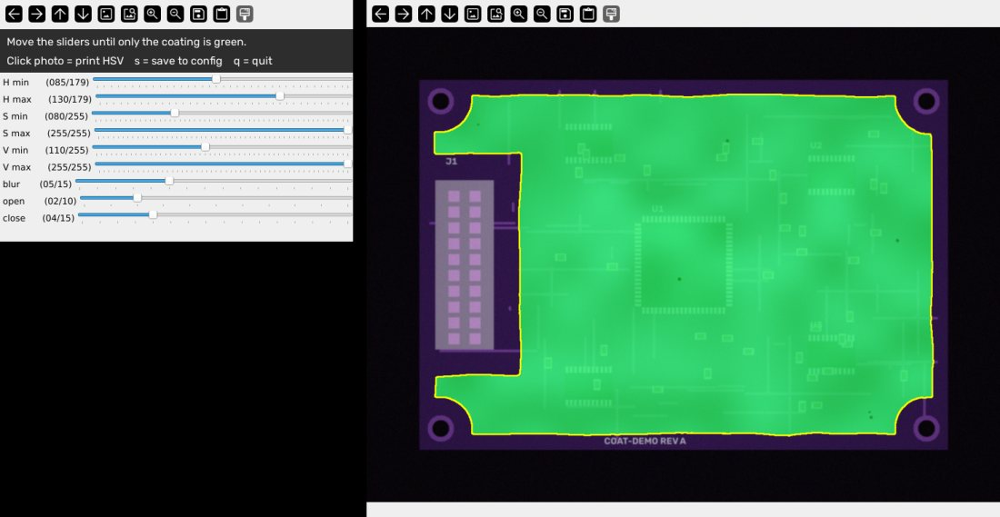

*Sliders on the left; on the right the photo with the detected coating tinted green and its border in yellow.*

1. Click the photo to print that pixel's HSV values in the terminal. Click coating, including thin edges and dim corners, and bare board.
2. Move the sliders until all coating is green and nothing else is.
3. Press <kbd>s</kbd> to save the values into `config.yaml` (its comments are kept), then <kbd>q</kbd> to quit.

The sample photos already match the saved values, so here you can just look and press <kbd>q</kbd>.

> **Tested on a virtual display:** clicking coating printed `HSV = (102, 133, 213)`, bare board printed `HSV = (136, 190, 75)` with `distance from previous click: 630.0 px`, <kbd>s</kbd> saved and <kbd>q</kbd> quit. The window needs the full `opencv-python` package; the "headless" variant has no windows.

## Step 7: Line up the photos

A board never sits in exactly the same place twice. ORB finds thousands of small details in both photos and pairs up similar ones. RANSAC keeps the pairs that agree on one shift and rotation and ignores the rest, including details that really changed, such as a moved coating edge. The photo is then warped onto the reference so every pixel can be compared.

**File: `coating_inspector/align.py`** (199 lines)

```python
"""Step 7: line up a board photo with the reference photo, so a board that sits a little shifted
or rotated in the fixture is not reported as a defect.
Quick check:  python -m coating_inspector.align samples/approved/approved_1.png samples/test/good_1.png"""
from __future__ import annotations  # lets newer type hints work on older Python versions

import math  # math.atan2 and math.degrees: work out the rotation angle
import sys  # sys.argv: the words typed after the command
from dataclasses import dataclass  # @dataclass: a class that simply holds named values

import cv2  # OpenCV: features (ORB), matching, RANSAC, warping
import numpy as np  # NumPy: matrices and arrays

from .common import load_config, read_image, write_image  # settings and image-file helpers


class AlignmentError(RuntimeError):
    """Raised when the photo cannot be matched to the reference photo."""


@dataclass  # turns the class below into a simple holder of the named values listed in it
class Alignment:
    """Everything align_to_reference finds out about one photo."""
    image: np.ndarray               # the photo, warped into the reference frame
    valid: np.ndarray               # 255 where the warped photo has real pixels
    matrix: np.ndarray              # 3x3 transform: photo pixel -> reference pixel
    inliers: int                    # matched features that agree with the transform
    shift_px: tuple                 # how far the board moved compared with the reference (x, y)...
    rotation_deg: float             # ...and how much it turned (counter-clockwise)


def _gray(image, scale):
    """Prepare a photo for finding features: grey, optionally shrunk, with faint detail boosted.

    Args:
        image: a BGR photo.
        scale: shrink factor (1.0 = keep the size).

    Returns:
        A grey (one-channel) image.
    """
    # Features need only brightness, not colour.
    gray = cv2.cvtColor(image, cv2.COLOR_BGR2GRAY)
    # Shrink large photos: features are found faster and just as reliably.
    if scale < 1:
        # Shrink by the factor; INTER_AREA gives the cleanest result.
        gray = cv2.resize(gray, None, fx=scale, fy=scale, interpolation=cv2.INTER_AREA)
    # CLAHE raises the contrast region by region, which brings out faint parts and tracks in dark areas.
    return cv2.createCLAHE(clipLimit=3.0, tileGridSize=(8, 8)).apply(gray)


def estimate_transform(reference, image, al: dict):
    """Work out how to move the photo onto the reference photo.

    ORB finds small distinctive details (corners of parts, pins, text) in both photos, similar
    details are paired up, and RANSAC keeps only the pairs that agree on one movement.

    Args:
        reference: the reference photo (BGR).
        image: the photo to line up (BGR).
        al: the "alignment" section of config.yaml.

    Returns:
        (matrix, inliers): a 3x3 transform from photo pixels to reference pixels, and how many
        feature pairs agree with it.
    """
    # Shrink factors, so neither photo is bigger than work_px on its long side (never enlarged).
    s_ref = min(1.0, al["work_px"] / max(reference.shape[:2]))
    s_img = min(1.0, al["work_px"] / max(image.shape[:2]))  # the same for the photo
    # ORB finds up to max_features details per photo and describes each one as a short binary code.
    orb = cv2.ORB_create(nfeatures=al["max_features"])
    # Find the details (keypoints: their positions) and their codes (descriptors) in both photos.
    kp_ref, des_ref = orb.detectAndCompute(_gray(reference, s_ref), None)
    kp_img, des_img = orb.detectAndCompute(_gray(image, s_img), None)  # the same for the photo being lined up
    # No details at all usually means a black, blank or very blurred photo.
    if des_ref is None or des_img is None:
        raise AlignmentError("no features found - is the photo dark or out of focus?")  # stop with this explanation
    # For every detail in the photo, find the 2 most similar details in the reference
    # (Hamming distance = how many bits of the two codes differ).
    pairs = cv2.BFMatcher(cv2.NORM_HAMMING).knnMatch(des_img, des_ref, k=2)
    # Ratio test: keep a match only if it is clearly better than the second-best one.
    good = [p[0] for p in pairs if len(p) == 2 and p[0].distance < 0.75 * p[1].distance]
    # Too few good matches: probably a different board or a very poor photo.
    if len(good) < al["min_inliers"]:
        # Stop with this explanation.
        raise AlignmentError(f"only {len(good)} matching features - is it the same board type?")
    # Positions of the matched details: src in the photo, dst in the reference.
    src = np.float32([kp_img[m.queryIdx].pt for m in good])
    dst = np.float32([kp_ref[m.trainIdx].pt for m in good])  # where the same details are in the reference
    # Shift + rotation (+ a tiny scale change): right for a fixed camera above a flat board.
    if al["method"] == "similarity":
        # RANSAC tries many random small sets of pairs and keeps the movement that most pairs agree with
        # (within 3 px); "inl" marks which pairs agree.
        affine, inl = cv2.estimateAffinePartial2D(src, dst, method=cv2.RANSAC, ransacReprojThreshold=3.0,
                                                  maxIters=5000, confidence=0.999)
        # Turn the 2x3 result into a 3x3 matrix by adding the row [0, 0, 1] (None if RANSAC failed).
        matrix = None if affine is None else np.vstack([affine, [0, 0, 1]])
    # Perspective as well: for a camera that is not square to the board.
    elif al["method"] == "homography":
        # The same RANSAC idea, with a full 3x3 perspective transform.
        matrix, inl = cv2.findHomography(src, dst, cv2.RANSAC, 3.0)
    # Any other method name is a typing mistake in config.yaml.
    else:
        raise ValueError(f"unknown alignment method '{al['method']}'")  # stop and show the wrong value
    # Count the agreeing pairs (inl holds a 1 for each of them).
    inliers = 0 if inl is None else int(inl.sum())
    # No result, or too few agreeing pairs: don't trust it.
    if matrix is None or inliers < al["min_inliers"]:
        # Stop with this explanation.
        raise AlignmentError(f"only {inliers} features agree - is it the same board type?")
    # The features were found on resized copies: convert the transform back to full-size pixels
    # (@ multiplies matrices: undo the reference shrink, apply the transform, apply the photo shrink).
    return np.diag([1 / s_ref, 1 / s_ref, 1]) @ matrix @ np.diag([s_img, s_img, 1]), inliers


def align_to_reference(reference, image, al: dict) -> Alignment:
    """Line up a photo with the reference photo.

    Args:
        reference: the reference photo (BGR).
        image: the photo to line up (BGR).
        al: the "alignment" section of config.yaml.

    Returns:
        An Alignment: the warped photo, which of its pixels are real, the transform and a description of it.
    """
    # Size of the reference photo: the warped photo gets exactly this size.
    h, w = reference.shape[:2]
    # With a precise fixture the photos already line up, so no movement is needed ...
    if al["method"] == "none":
        # ... but only if both photos have the same size.
        if image.shape != reference.shape:
            raise AlignmentError("photo size differs from the reference photo")  # stop with this explanation
        # np.eye(3) is the "do nothing" transform; there are no feature pairs to count.
        matrix, inliers = np.eye(3), 0
    # Otherwise work out the movement from the photos themselves.
    else:
        matrix, inliers = estimate_transform(reference, image, al)  # find the movement with ORB features and RANSAC
    # Move every pixel of the photo to its place in the reference frame.
    warped = cv2.warpPerspective(image, matrix, (w, h), flags=cv2.INTER_LINEAR)
    # Move an all-white picture the same way: white = pixels that really came from the photo.
    valid = cv2.warpPerspective(np.full(image.shape[:2], 255, np.uint8), matrix, (w, h), flags=cv2.INTER_NEAREST)
    # Shrink that area by 2 px, to ignore the blurry edge of the warped photo.
    valid = cv2.erode(valid, np.ones((5, 5), np.uint8))
    # Describe the movement: where did the centre of the reference end up in the photo?
    # The inverse matrix maps reference pixels to photo pixels.
    to_photo = np.linalg.inv(matrix)
    # The reference centre as (x, y, 1); the extra 1 lets a 3x3 matrix apply a shift too.
    centre = np.array([w / 2, h / 2, 1.0])
    # Where that point lands in the photo.
    moved = to_photo @ centre
    # Divide by the third number (needed for perspective transforms; it is 1 otherwise).
    moved /= moved[2]
    # The shift is how far the centre moved, in x and in y.
    shift = (float(moved[0] - centre[0]), float(moved[1] - centre[1]))
    # The rotation angle, from the matrix's top row, in degrees (counter-clockwise).
    rotation = math.degrees(math.atan2(to_photo[0, 1], to_photo[0, 0]))
    # Package everything up.
    return Alignment(warped, valid, matrix, inliers, shift, rotation)


def _detail(image):
    """Keep only fine detail (edges of parts and tracks), without slow brightness changes.

    Used for the check picture, so differences in coating thickness don't look like misalignment.

    Args:
        image: a BGR photo.

    Returns:
        A grey image where edges are bright and flat areas are dark.
    """
    # Grey values as decimals, so the subtraction below can go negative.
    gray = cv2.cvtColor(image, cv2.COLOR_BGR2GRAY).astype(np.float32)
    # Photo minus a blurred copy = only the fine detail; abs() makes dark and bright edges both positive.
    detail = np.abs(gray - cv2.GaussianBlur(gray, (0, 0), 3))
    # Stretch so the strongest 0.5 % of the detail becomes white (255), then convert to 8-bit.
    return np.clip(detail * (255 / max(np.percentile(detail, 99.5), 1)), 0, 255).astype(np.uint8)


# This block runs only when the file is started with  python -m coating_inspector.align <ref> <photo>
if __name__ == "__main__":
    # Exactly two photos must be given.
    if len(sys.argv) != 3:
        # Otherwise show how to use it and stop.
        sys.exit("usage: python -m coating_inspector.align <reference photo> <photo>")
    # Read the settings ...
    cfg = load_config()
    # ... and both photos.
    reference, image = read_image(sys.argv[1]), read_image(sys.argv[2])
    # Line up the second photo with the first.
    a = align_to_reference(reference, image, cfg["alignment"])
    # Report how many features agreed and how the board was placed.
    print(f"{a.inliers} matching features: board shifted {a.shift_px[0]:+.1f}, {a.shift_px[1]:+.1f} px "
          f"and rotated {a.rotation_deg:+.2f} deg compared with the reference")
    # Check picture: the aligned photo's detail in blue + green (= cyan), the reference's detail in red.
    # Detail present in both looks white; misaligned detail shows up as red/cyan doubles.
    write_image("out/align_check.png", cv2.merge([_detail(a.image), _detail(a.image), _detail(reference)]))
    # Tell the user where the check picture is.
    print("saved out/align_check.png (white parts = lined up, red/cyan doubled parts = not lined up)")
```

```shell
python -m coating_inspector.align samples/approved/approved_1.png samples/test/good_1.png
```

**Expected output**

```text
329 matching features: board shifted +17.9, +8.9 px and rotated +1.30 deg compared with the reference
saved out/align_check.png (white parts = lined up, red/cyan doubled parts = not lined up)
```

`truth.json` says good_1 was placed with a shift of (18, 9) px and a rotation of 1.3°, so the measurement is within 0.1 px. The number of matching features can differ slightly between OpenCV versions.

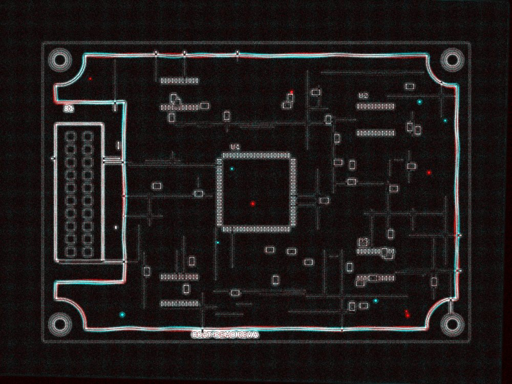

*`out/align_check.png`: parts and tracks show white because they line up. Misaligned photos would show every part as a red/cyan double. The coating edge and bubbles keep some colour because they really differ from board to board.*

> **Alignment needs board detail.** If your photos show nothing but the glowing coating (for example with a strong camera filter), add a little white light, or use a precise fixture and set `method: none`.

## Step 8: Build the golden pattern

The golden pattern records where coating must be, taken from boards that QA has approved. Each approved photo is lined up with the first one and segmented, and a pixel counts as "must coat" when most boards agree. Three to five boards average out normal variation. The optional keep-out mask marks areas that must never be coated, such as connectors and test points.

**File: `coating_inspector/golden.py`** (190 lines)

```python
"""Step 8: build the approved ("golden") coating pattern from photos of approved boards.
Run:  python -m coating_inspector.golden --images samples/approved --keepout samples/keepout_mask.png --out golden"""
from __future__ import annotations  # lets the type hint "np.ndarray | None" work on older Python versions

import argparse  # reads the options typed after the command
import json  # writes golden.json (a record of how the pattern was made)
from dataclasses import dataclass  # @dataclass: a class that simply holds named values
from datetime import datetime  # the date and time recorded in golden.json
from pathlib import Path  # handles file and folder paths

import cv2  # OpenCV: drawing the preview, counting pixels
import numpy as np  # NumPy: arrays and per-pixel maths

from .align import align_to_reference  # lines each approved photo up with the first one
from .common import find_images, load_config, read_image, read_mask, write_image  # file helpers
from .segment import find_borders, remove_small_blobs, segment_coating  # coating detection


@dataclass  # turns the class below into a simple holder of the named values listed in it
class Golden:
    """The approved pattern: what every board is compared with."""
    reference: np.ndarray           # photo of the first approved board; every photo is aligned to it
    mask: np.ndarray                # 255 = must be coated
    keepout: np.ndarray | None      # 255 = must never be coated (None if no keep-out mask was given)
    info: dict                      # how and when the pattern was made (the contents of golden.json)


def read_keepout(path) -> np.ndarray:
    """Read the keep-out zones.

    Accepts either a black/white mask (white = keep-out) or a copy of reference.png with the
    zones painted pure magenta (red 255, green 0, blue 255).

    Args:
        path: the keep-out picture.

    Returns:
        A 0/255 mask: 255 inside the keep-out zones.
    """
    # Split the picture into its blue, green and red channels.
    b, g, r = cv2.split(read_image(path))
    # Pure magenta pixels: lots of blue and red, almost no green.
    painted = (b > 230) & (r > 230) & (g < 40)
    # If anything was painted magenta, those pixels are the zones.
    if painted.any():
        return np.where(painted, 255, 0).astype(np.uint8)  # painted pixels become 255, all others 0
    # Otherwise treat the picture as a black/white mask.
    return read_mask(path)


def build_golden(image_paths, cfg, out_dir, keepout_path=None) -> Golden:
    """Build the golden pattern from photos of approved boards and save it.

    Args:
        image_paths: photos of approved boards; the first one becomes the reference.
        cfg: all settings from config.yaml.
        out_dir: the folder to save the pattern in.
        keepout_path: optional keep-out picture.

    Returns:
        The finished Golden pattern.
    """
    # The segmentation settings are used for every photo.
    seg = cfg["segmentation"]
    # The first approved photo is the reference: all other photos are lined up with it.
    reference = read_image(image_paths[0])
    # Votes per pixel: 1 where the reference is coated, 0 elsewhere (as decimals, for the maths below).
    votes = (segment_coating(reference, seg) > 0).astype(np.float32)
    # How many photos really cover each pixel; the reference covers all of them.
    seen = np.ones_like(votes)
    # Every other approved photo adds its votes.
    for path in image_paths[1:]:
        # Line this photo up with the reference.
        a = align_to_reference(reference, read_image(path), cfg["alignment"])
        # Add 1 where this photo is coated and the pixel is real (not outside the warped photo).
        votes += (segment_coating(a.image, seg) > 0) & (a.valid > 0)
        # Add 1 where this photo has real pixels.
        seen += a.valid > 0
        # Show how this board was placed compared with the reference.
        print(f"  aligned {Path(path).name}: shifted {a.shift_px[0]:+.1f}, {a.shift_px[1]:+.1f} px, "
              f"rotated {a.rotation_deg:+.2f} deg")
    # "Must coat" where more than min_agreement (0.5 = most) of the photos are coated.
    mask = np.where(votes > cfg["golden"]["min_agreement"] * seen, 255, 0).astype(np.uint8)
    # Drop tiny specks from the result.
    mask = remove_small_blobs(mask, seg["min_area_px"])

    # Read the keep-out zones, if a file was given.
    keepout = read_keepout(keepout_path) if keepout_path else None
    # The keep-out picture must match the reference photo pixel for pixel.
    if keepout is not None and keepout.shape != mask.shape:
        raise ValueError("the keep-out mask must be the same size as the reference photo")  # stop with this message
    # Approved boards should never have coating inside a keep-out zone: warn if they do.
    if keepout is not None and np.any((mask > 0) & (keepout > 0)):
        # Warn, but carry on.
        print("  WARNING: the approved boards have coating inside a keep-out zone - check the keep-out mask")

    # Save the pattern into the output folder: the reference photo and the must-coat mask.
    out = Path(out_dir)
    write_image(out / "reference.png", reference)  # the photo every board is lined up with
    write_image(out / "coating_mask.png", mask)  # white = must be coated
    # A preview for a person to check: the reference with the approved outline in yellow ...
    preview = reference.copy()
    cv2.drawContours(preview, find_borders(mask), -1, (0, 255, 255), 2)  # yellow, 2 px thick
    # ... and, if there is one, the keep-out mask saved and its outline drawn in magenta.
    if keepout is not None:
        write_image(out / "keepout_mask.png", keepout)  # save the keep-out mask
        cv2.drawContours(preview, find_borders(keepout), -1, (255, 0, 255), 2)  # magenta, 2 px thick
    write_image(out / "preview.png", preview)  # save the preview picture
    # A record of how the pattern was made: when, from which photos and with which settings.
    info = {"created": datetime.now().isoformat(timespec="seconds"),
            "images": [str(p) for p in image_paths],
            "keepout": str(keepout_path) if keepout_path else None,
            "segmentation": seg}
    # Save that record as golden.json.
    (out / "golden.json").write_text(json.dumps(info, indent=2), encoding="utf-8")
    # Hand back the finished pattern.
    return Golden(reference, mask, keepout, info)


def load_golden(folder) -> Golden:
    """Load a golden pattern saved by build_golden.

    Args:
        folder: the folder build_golden wrote to.

    Returns:
        The Golden pattern.
    """
    # Accept a plain text path or a Path object.
    folder = Path(folder)
    # Without coating_mask.png there is no pattern: explain what to do.
    if not (folder / "coating_mask.png").exists():
        # Stop with this message.
        raise FileNotFoundError(f"no golden pattern in {folder}/ - build it first with coating_inspector.golden")
    # The two optional files.
    keepout = folder / "keepout_mask.png"  # the keep-out zones
    info = folder / "golden.json"  # the record of how the pattern was made
    # Read everything; a missing optional file becomes None or an empty record.
    return Golden(read_image(folder / "reference.png"),
                  read_mask(folder / "coating_mask.png"),
                  read_mask(keepout) if keepout.exists() else None,
                  json.loads(info.read_text(encoding="utf-8")) if info.exists() else {})


def main(argv=None) -> int:
    """Command line: python -m coating_inspector.golden --images ... [--keepout ...] [--out ...]

    Args:
        argv: the command-line words; None means "use the ones typed in the terminal".

    Returns:
        0, the exit code for success.
    """
    # Describe the options this command accepts.
    ap = argparse.ArgumentParser(description="Build the golden coating pattern from approved boards.")
    # --images: one or more approved photos, folders or wildcards.
    ap.add_argument("--images", nargs="+", required=True,
                    help="photos of approved boards (files, folders or wildcards); the first is the reference")
    # --keepout: the keep-out picture (optional).
    ap.add_argument("--keepout", help="optional keep-out mask (white = must stay uncoated)")
    ap.add_argument("--out", default="golden")  # --out: where to save the pattern
    ap.add_argument("--config", default="config.yaml")  # --config: the settings file
    # Read what the user typed.
    args = ap.parse_args(argv)
    # Load the settings.
    cfg = load_config(args.config)
    # Turn files, folders and wildcards into a list of photos.
    paths = find_images(args.images)
    # Nothing found: stop with an error message (argparse prints it and exits).
    if not paths:
        ap.error("no images found")  # argparse prints the message and stops the program
    # Say what is about to happen.
    print(f"building the golden pattern from {len(paths)} approved board(s), reference = {paths[0].name}")
    # Build and save the pattern.
    golden = build_golden(paths, cfg, args.out, args.keepout)
    # Report its coated area in mm2 and how many outlines it has.
    ppm = cfg["tolerance"]["pixels_per_mm"]
    # Print the area (pixel count divided by pixels-per-mm squared = mm2) and the number of outlines.
    print(f"saved {args.out}/: coated area {cv2.countNonZero(golden.mask) / ppm**2:.0f} mm2, "
          f"{len(find_borders(golden.mask))} outline(s)")
    # Remind the user to check the preview.
    print(f"open {args.out}/preview.png and check that the yellow outline matches the coating drawing")
    # Exit code 0 = success.
    return 0


# This block runs only when the file is started with  python -m coating_inspector.golden ...
if __name__ == "__main__":
    # Run main() and hand its return value to the operating system as the exit code.
    raise SystemExit(main())
```

```shell
python -m coating_inspector.golden --images samples/approved --keepout samples/keepout_mask.png --out golden
```

**Expected output**

```text
building the golden pattern from 3 approved board(s), reference = approved_1.png
  aligned approved_2.png: shifted +11.9, -7.0 px, rotated +0.81 deg
  aligned approved_3.png: shifted -9.1, +10.0 px, rotated -0.59 deg
saved golden/: coated area 5209 mm2, 1 outline(s)
open golden/preview.png and check that the yellow outline matches the coating drawing
```

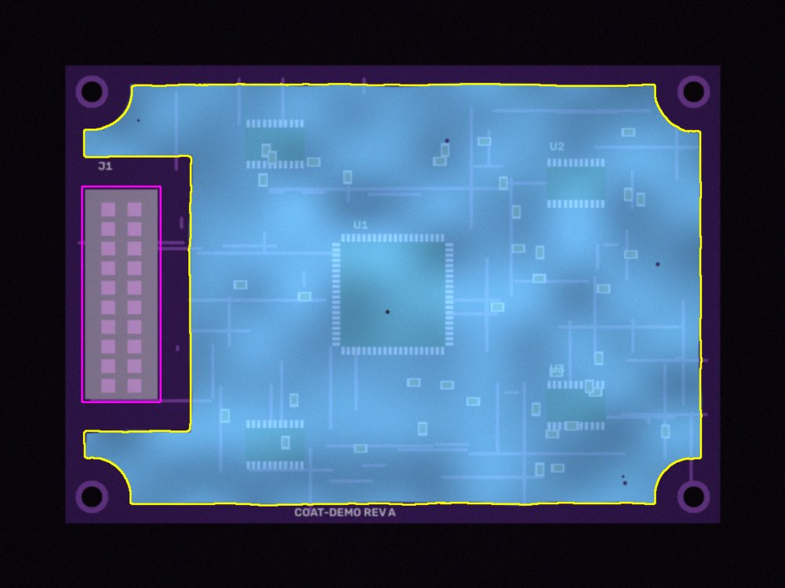

*`golden/preview.png`: yellow is the approved coating outline, magenta the keep-out zone.*

The `golden` folder now holds `reference.png`, `coating_mask.png`, `keepout_mask.png`, `preview.png` and `golden.json`. The mask is a plain black-and-white picture, so you can correct it in any paint program (white = must coat).

## Step 9: Compare, report and check boards

Three files finish the tool. `compare.py` applies the tolerance band from [How it works](#how-it-works-and-reading-the-code), `report.py` draws the result picture and writes the JSON report, and `check.py` runs everything over a list of photos.

**File: `coating_inspector/compare.py`** (228 lines)

```python
"""Step 9: compare a board's coating with the golden pattern and decide PASS or FAIL."""
from __future__ import annotations  # lets newer type hints work on older Python versions

from dataclasses import dataclass, field  # @dataclass holds named values; field() sets options for one value

import cv2  # OpenCV: erode/dilate, connected areas, distance transform
import numpy as np  # NumPy: per-pixel True/False maths

from .align import Alignment, align_to_reference  # lines the photo up with the golden reference photo
from .segment import disk, find_borders, segment_coating  # round brush, outlines, coating detection


@dataclass  # turns the class below into a simple holder of the named values listed in it
class Defect:
    """One defect found on a board."""
    kind: str                       # "missing", "excess" or "keepout"
    area_mm2: float                 # its size in square millimetres
    box: tuple                      # x, y, width, height in pixels of the golden reference photo


@dataclass  # turns the class below into a simple holder of the named values listed in it
class Comparison:
    """The result of comparing one board with the golden pattern."""
    passed: bool                    # True = PASS, False = FAIL
    reasons: list                   # why it failed, in words (empty when it passed)
    metrics: dict                   # measurements: coverage, outline match, edge deviation, areas ...
    defects: list                   # the Defect objects found
    layers: dict = field(repr=False)    # masks used to draw the result picture (left out when printed)


@dataclass  # turns the class below into a simple holder of the named values listed in it
class Inspection:
    """Everything known about one inspected photo."""
    aligned: np.ndarray             # the photo, lined up with the golden reference photo
    mask: np.ndarray                # the coating found in the photo
    alignment: Alignment            # how the photo was lined up
    comparison: Comparison          # the PASS/FAIL result and measurements


def inspect_image(image, golden, cfg) -> Inspection:
    """Inspect one photo: line it up, find its coating and compare it with the golden pattern.

    Args:
        image: the board photo (BGR).
        golden: the Golden pattern.
        cfg: all settings from config.yaml.

    Returns:
        An Inspection with the aligned photo, the coating mask, the alignment and the result.
    """
    # 1. Line the photo up with the golden reference photo.
    alignment = align_to_reference(golden.reference, image, cfg["alignment"])
    # 2. Find the coating in the lined-up photo.
    mask = segment_coating(alignment.image, cfg["segmentation"])
    # 3. Compare that coating with the golden pattern.
    comparison = compare_masks(mask, golden.mask, alignment.valid, golden.keepout, cfg["tolerance"])
    # Bundle everything together for the report.
    return Inspection(alignment.image, mask, alignment, comparison)


def _edge_pixels(mask):
    """Find the outline pixels of a mask.

    Args:
        mask: a 0/255 mask.

    Returns:
        A True/False array: True on the outline (1 px wide).
    """
    # Start with an all-black picture.
    edges = np.zeros(mask.shape, np.uint8)
    # Draw every outline in white, 1 px wide.
    cv2.drawContours(edges, find_borders(mask), -1, 255, 1)
    # True where an outline was drawn.
    return edges > 0


def _distance_to(pixels):
    """For every pixel, measure the distance in px to the nearest True pixel of `pixels`.

    Args:
        pixels: a True/False array (for example an outline).

    Returns:
        A decimal array of distances in pixels.
    """
    # distanceTransform measures the distance to the nearest 0 (black) pixel, so the True pixels become 0.
    # DIST_L2 = straight-line distance; DIST_MASK_PRECISE = exact rather than approximate.
    return cv2.distanceTransform(np.where(pixels, 0, 255).astype(np.uint8), cv2.DIST_L2, cv2.DIST_MASK_PRECISE)


def _blobs(region, kind, min_area_px, px_per_mm):
    """Split a region into separate areas and keep those big enough to count as defects.

    Args:
        region: a True/False array, for example "should be coated but is not".
        kind: the defect type to record ("missing", "excess" or "keepout").
        min_area_px: the smallest area that counts, in pixels.
        px_per_mm: for converting areas to mm2.

    Returns:
        (defects, mask): a list of Defect objects, and a True/False mask of just those areas.
    """
    # Number every separate area and measure its bounding box and size.
    count, labels, stats, _ = cv2.connectedComponentsWithStats(region.astype(np.uint8), connectivity=8)
    # Which area numbers to keep: none yet.
    keep = np.zeros(count, bool)
    # The defects found so far: none yet.
    defects = []
    # Check every area (number 0 is the background, so start at 1).
    for i in range(1, count):
        # Its bounding box (x, y, width, height) and area in pixels, as plain whole numbers.
        x, y, w, h, area = (int(v) for v in stats[i])
        # Big enough to count?
        if area >= min_area_px:
            # Keep it in the mask ...
            keep[i] = True
            # ... and record it as a defect, with its area converted to mm2.
            defects.append(Defect(kind, round(area / px_per_mm**2, 2), (x, y, w, h)))
    # The defects, and a mask that is True only on the kept areas.
    return defects, keep[labels]


def compare_masks(test_mask, golden_mask, valid, keepout, tol) -> Comparison:
    """Compare a board's coating with the golden pattern.

    Args:
        test_mask: the coating found on the board (0/255), lined up with the golden pattern.
        golden_mask: where coating must be (0/255).
        valid: 255 where the board photo has real pixels.
        keepout: the keep-out zones (0/255), or None.
        tol: the "tolerance" section of config.yaml.

    Returns:
        A Comparison with PASS/FAIL, reasons, measurements, defects and drawing layers.
    """
    # The photo's scale.
    ppm = tol["pixels_per_mm"]
    # The allowed edge wander, converted from mm to pixels (at least 1 px).
    band = max(1, round(tol["border_mm"] * ppm))
    # Only judge the pixels the photo really covers.
    inside = valid > 0
    # The board's coating, as True/False.
    test = (test_mask > 0) & inside
    # Where the golden pattern has coating, as True/False.
    golden = (golden_mask > 0) & inside
    # The keep-out zones as True/False (all False when there are none).
    keep_out = (keepout > 0) & inside if keepout is not None else np.zeros_like(test)
    # "Must coat": the golden area shrunk by the tolerance band (erode = shrink).
    must_coat = (cv2.erode(golden_mask, disk(band)) > 0) & inside
    # "May coat": the golden area grown by the tolerance band (dilate = grow).
    may_coat = cv2.dilate(golden_mask, disk(band)) > 0

    # The smallest defect that counts, converted from mm2 to pixels.
    min_px = tol["min_defect_mm2"] * ppm**2
    # Missing coating: must be coated, but is not (~ means "not").
    missing, missing_px = _blobs(must_coat & ~test, "missing", min_px, ppm)
    # Excess coating: coated where not even "may coat" (keep-out zones are counted separately below).
    excess, excess_px = _blobs(test & ~may_coat & ~keep_out, "excess", min_px, ppm)
    # Keep-out defects: coated inside a keep-out zone, with their own (smaller) minimum size.
    in_keepout, keepout_px = _blobs(test & keep_out, "keepout", tol["keepout_min_mm2"] * ppm**2, ppm)

    # Outline comparison: from every edge pixel, how far is the nearest edge pixel of the other outline?
    # Ignore outline pixels within 3 px of the photo's edge, where outlines are cut off artificially.
    usable = cv2.erode(valid, disk(3)) > 0
    # The outline pixels of the board's coating and of the golden pattern.
    test_edge, golden_edge = _edge_pixels(test_mask), _edge_pixels(golden_mask)
    # Defaults for when there is no outline at all (for example when no coating is found).
    dev_test = np.zeros(test_mask.shape, np.float32)
    deviations = np.array([])  # an empty list of distances
    # Only measure when both outlines exist.
    if test_edge.any() and golden_edge.any():
        # Every pixel's distance to the approved edge (read off at the measured edge below).
        dev_test = _distance_to(golden_edge)
        # Every pixel's distance to the measured edge (read off at the approved edge below).
        dev_golden = _distance_to(test_edge)
        # All the distances, both ways: measured -> approved and approved -> measured.
        deviations = np.concatenate([dev_test[test_edge & usable], dev_golden[golden_edge & usable]])
    # Were there any distances to summarise?
    found = deviations.size > 0

    # The measurements, rounded for the report (float() turns NumPy numbers into plain Python numbers).
    metrics = {
        # Share of the must-coat area that is coated, in %.
        "coverage_pct": round(float(100 * (must_coat & test).sum() / max(must_coat.sum(), 1)), 2),
        # Share of the outline points that lie within the tolerance band, in %.
        "outline_match_pct": round(float(100 * np.mean(deviations <= band)), 2) if found else 0.0,
        # 95 % of the outline points are closer than this to the other outline, in mm.
        "edge_deviation_p95_mm": round(float(np.percentile(deviations, 95) / ppm), 3) if found else None,
        # The largest outline distance, in mm.
        "edge_deviation_max_mm": round(float(deviations.max() / ppm), 3) if found else None,
        # Overlap of coating and golden pattern: shared area / combined area (1.0 = identical).
        "iou": round(float((golden & test).sum() / max((golden | test).sum(), 1)), 4),
        # The coated area on the board, in mm2.
        "coated_area_mm2": round(float(test.sum() / ppm**2), 1),
        # The coated area in the golden pattern, in mm2.
        "golden_area_mm2": round(float(golden.sum() / ppm**2), 1),
    }
    # Collect every reason to fail, in words.
    reasons = []
    # No coating at all usually means the light or the colour settings are wrong.
    if not test.any():
        reasons.append("no coating found - check the light and the colour settings")  # add this reason to the list
    # Coating inside a keep-out zone.
    if in_keepout:
        reasons.append(f"coating in keep-out zone ({len(in_keepout)})")  # the reason, with how many were found
    # Missing coating.
    if missing:
        reasons.append(f"missing coating ({len(missing)})")  # the reason, with how many were found
    # Coating outside the pattern.
    if excess:
        reasons.append(f"coating outside pattern ({len(excess)})")  # the reason, with how many were found
    # Too little of the must-coat area is coated, even if no single gap is big enough to count.
    if metrics["coverage_pct"] < tol["min_coverage_pct"]:
        # The reason, with the measured and the required %.
        reasons.append(f"coverage {metrics['coverage_pct']}% < {tol['min_coverage_pct']}%")
    # Too much of the outline is outside the tolerance band (for example a shifted pattern).
    if metrics["outline_match_pct"] < tol["min_outline_match_pct"]:
        # The reason, with the measured %.
        reasons.append(f"only {metrics['outline_match_pct']}% of outline within {tol['border_mm']} mm")

    # Masks for the result picture: the defect areas, plus the measured outline split into pixels within
    # tolerance (edge_ok, drawn green) and outside it (edge_bad, drawn red).
    layers = {"missing": missing_px, "excess": excess_px, "keepout": keepout_px,
              "edge_ok": test_edge & usable & (dev_test <= band),
              "edge_bad": test_edge & usable & (dev_test > band)}
    # PASS when there is no reason to fail; keep-out defects are listed first.
    return Comparison(not reasons, reasons, metrics, in_keepout + missing + excess, layers)
```

**File: `coating_inspector/report.py`** (135 lines)

```python
"""Step 9: draw the result picture and write the JSON report."""
from __future__ import annotations  # lets newer type hints work on older Python versions

import json  # writes the JSON report
from dataclasses import asdict  # turns a Defect into a plain dictionary for the JSON report
from pathlib import Path  # handles file paths

import cv2  # OpenCV: drawing outlines, boxes and text
import numpy as np  # NumPy: per-pixel colour blending

from .segment import disk, find_borders  # round brush and outline tracing

FILL = {"missing": (0, 0, 255), "excess": (0, 165, 255), "keepout": (255, 0, 255)}  # BGR: red, orange, magenta
WHITE, GREEN, RED = (255, 255, 255), (0, 220, 0), (0, 0, 255)  # more colours, also in BGR order
LEGEND = ("white = approved outline | green/red = measured outline in/out of tolerance | "
          "fill: red = missing, orange = excess, magenta = keep-out")  # text for the bar at the bottom


def _text_bar(img, text, colour, scale, at_bottom=False):
    """Write text on a coloured bar across the top (or bottom) of the picture.

    Args:
        img: the picture to draw on (changed in place).
        text: the text to write.
        colour: the bar's colour (BGR).
        scale: the text size; reduced automatically if the text is too wide.
        at_bottom: True for the bottom of the picture, False for the top.
    """
    # The font, and a line thickness that grows with the text size.
    font, thick = cv2.FONT_HERSHEY_SIMPLEX, max(1, round(2 * scale))
    # Measure the text: its width, its height, and how far letters such as "g" hang below the line.
    (tw, th), base = cv2.getTextSize(text, font, scale, thick)
    # Too wide for the picture? Shrink the text so it fits with 10 px to spare on each side.
    if tw > img.shape[1] - 20:
        scale *= (img.shape[1] - 20) / tw  # shrink the text size in proportion
        thick = max(1, round(2 * scale))  # line thickness for the new size
        (tw, th), base = cv2.getTextSize(text, font, scale, thick)  # measure again
    # The bar's height: the text, the part hanging below the line, and 16 px of padding.
    height = th + base + 16
    # The bar's top edge: at the bottom of the picture or at the very top.
    top = img.shape[0] - height if at_bottom else 0
    # Draw the filled bar across the full width ...
    cv2.rectangle(img, (0, top), (img.shape[1], top + height), colour, -1)
    # ... and the white text on it.
    cv2.putText(img, text, (10, top + th + 8), font, scale, WHITE, thick, cv2.LINE_AA)


def draw_overlay(inspection, golden) -> np.ndarray:
    """Draw the result picture for one board.

    Args:
        inspection: the Inspection of the board.
        golden: the Golden pattern it was compared with.

    Returns:
        The lined-up photo with defects filled in colour, both outlines, labels and a PASS/FAIL bar.
    """
    # The comparison holds the defects and the drawing layers.
    comp = inspection.comparison
    # Start from the lined-up photo, darkened to 70 % so the coloured marks stand out.
    img = (inspection.aligned * 0.7).astype(np.uint8)
    # Size factor for lines and text: 1.0 for a 1200 px photo, bigger for bigger photos.
    scale = max(img.shape[:2]) / 1200
    # Line thickness in pixels (at least 1).
    line = max(1, round(2 * scale))
    # Fill each kind of defect area with its colour.
    for kind, colour in FILL.items():
        # The True/False mask of this kind's defect areas.
        area = comp.layers[kind]
        # Mix 40 % photo with 60 % colour, so the board stays visible underneath.
        img[area] = (0.4 * img[area] + 0.6 * np.array(colour)).astype(np.uint8)
    # Outline the keep-out zones in magenta, if there are any.
    if golden.keepout is not None:
        # Trace the zones and draw their outlines.
        cv2.drawContours(img, find_borders(golden.keepout), -1, FILL["keepout"], line)
    # Draw the approved outline in white.
    cv2.drawContours(img, find_borders(golden.mask), -1, WHITE, line)
    # Draw the measured outline on top: green where it is within tolerance, red where it is not.
    for key, colour in (("edge_ok", GREEN), ("edge_bad", RED)):
        # Thicken the 1 px outline (dilate) so it is visible, then paint those pixels.
        img[cv2.dilate(comp.layers[key].astype(np.uint8), disk(max(1, line // 2))) > 0] = colour
    # The font and text size for the defect labels.
    font, text_scale = cv2.FONT_HERSHEY_SIMPLEX, 0.6 * scale
    # Box and label each defect.
    for d in comp.defects:
        # The defect's bounding box.
        x, y, w, h = d.box
        # Draw the box a little larger than the defect, so it doesn't cover it.
        pad = 4 * line
        # Draw the box in the defect's colour.
        cv2.rectangle(img, (x - pad, y - pad), (x + w + pad, y + h + pad), FILL[d.kind], line)
        # The label, for example "missing 28.8 mm2".
        label = f"{d.kind} {d.area_mm2:.1f} mm2"
        # Measure the label, so it can be kept inside the picture.
        (tw, th), _ = cv2.getTextSize(label, font, text_scale, line)
        # Put the label above the box, moved left or down if it would leave the picture.
        tx = min(max(0, x - pad), img.shape[1] - tw - 4)
        ty = max(th + 4, y - pad - 6)  # just above the box, but never above the picture's top
        # A black background makes the label readable on any part of the board ...
        cv2.rectangle(img, (tx - 2, ty - th - 4), (tx + tw + 2, ty + 4), (0, 0, 0), -1)
        # ... with the label written in the defect's colour.
        cv2.putText(img, label, (tx, ty), font, text_scale, FILL[d.kind], line, cv2.LINE_AA)
    # The verdict text: PASS, or FAIL followed by the reasons.
    verdict = "PASS" if comp.passed else "FAIL: " + "; ".join(comp.reasons)
    # Write it on a green (PASS) or red (FAIL) bar at the top.
    _text_bar(img, verdict, (0, 130, 0) if comp.passed else (0, 0, 190), 0.9 * scale)
    # The colour legend goes on a dark bar at the bottom.
    _text_bar(img, LEGEND, (40, 40, 40), 0.5 * scale, at_bottom=True)
    # The finished picture.
    return img


def write_report(path, image_path, inspection) -> None:
    """Write the JSON report for one board.

    Args:
        path: where to save the report (.json).
        image_path: the photo that was inspected (recorded in the report).
        inspection: the Inspection of the board.
    """
    # Short names for the two parts used below.
    comp, al = inspection.comparison, inspection.alignment
    # Everything worth keeping, as dictionaries, lists, text and numbers (the things JSON can store).
    report = {
        "image": str(image_path),                                  # which photo
        "result": "PASS" if comp.passed else "FAIL",               # the verdict
        "reasons": comp.reasons,                                   # why it failed (empty if it passed)
        "metrics": comp.metrics,                                   # the measurements
        "defects": [asdict(d) for d in comp.defects],              # each defect as a dictionary
        "alignment": {"inliers": al.inliers,                       # how well the photo lined up ...
                      "shift_px": [round(v, 2) for v in al.shift_px],  # ... how far the board was shifted
                      "rotation_deg": round(al.rotation_deg, 3)},  # ... and how much it was rotated
    }
    # Save it as indented, readable JSON text.
    Path(path).write_text(json.dumps(report, indent=2), encoding="utf-8")
```

**File: `coating_inspector/check.py`** (100 lines)

```python
"""Step 9: check board photos against the golden pattern.
Run:  python -m coating_inspector.check --golden golden --images samples/test --out results"""
from __future__ import annotations  # lets newer type hints work on older Python versions

import argparse  # reads the options typed after the command
import csv  # writes summary.csv (which opens in Excel)
from pathlib import Path  # handles file and folder paths

from .align import AlignmentError  # raised when a photo cannot be lined up
from .common import find_images, load_config, read_image, write_image  # settings and file helpers
from .compare import inspect_image  # inspects one photo
from .golden import load_golden  # loads the approved pattern
from .report import draw_overlay, write_report  # result picture and JSON report


def main(argv=None) -> int:
    """Command line: check every given photo and write pictures, reports and a summary.

    Args:
        argv: the command-line words; None means "use the ones typed in the terminal".

    Returns:
        The exit code: 0 if every board passed, 1 if any failed or could not be checked.
    """
    # Describe the options this command accepts.
    ap = argparse.ArgumentParser(description="Check boards against the golden coating pattern.")
    # --golden: the folder with the golden pattern (default: golden).
    ap.add_argument("--golden", default="golden", help="folder made by coating_inspector.golden")
    # --images: one or more photos, folders or wildcards (required).
    ap.add_argument("--images", nargs="+", required=True, help="board photos (files, folders or wildcards)")
    # --out: where the results are written (default: results).
    ap.add_argument("--out", default="results", help="folder for result pictures and reports")
    ap.add_argument("--config", default="config.yaml")  # --config: the settings file
    # Read what the user typed.
    args = ap.parse_args(argv)
    # Load the settings ...
    cfg = load_config(args.config)
    # ... and the approved pattern.
    golden = load_golden(args.golden)
    # Turn files, folders and wildcards into a list of photos.
    paths = find_images(args.images)
    # Nothing found: stop with an error message.
    if not paths:
        ap.error("no images found")  # argparse prints the message and stops the program
    # Create the output folder (no error if it already exists).
    out = Path(args.out)
    out.mkdir(parents=True, exist_ok=True)  # parents=True also creates any missing parent folders

    # One summary row per board, for summary.csv.
    rows = []
    # The table heading; each column is padded to a fixed width (<24 = left-aligned in 24 characters).
    print(f"{'board':<24}{'result':<8}{'coverage':>9}{'outline':>9}  details")
    # Inspect the photos one by one.
    for path in paths:
        # Try the inspection ...
        try:
            # Read the photo, then align, segment and compare.
            inspection = inspect_image(read_image(path), golden, cfg)
        # ... and if the photo can't be lined up, report an ERROR row instead of stopping everything.
        except AlignmentError as err:
            print(f"{path.name:<24}{'ERROR':<8}{'':>18}  {err}")  # an ERROR row in the table, with the reason
            rows.append({"board": path.name, "result": "ERROR", "details": str(err)})  # recorded for summary.csv too
            # Go on with the next photo.
            continue
        # The comparison result.
        comp = inspection.comparison
        # Save the result picture, the coating mask and the JSON report, named after the photo.
        write_image(out / f"{path.stem}_result.png", draw_overlay(inspection, golden))  # the marked-up result picture
        write_image(out / f"{path.stem}_mask.png", inspection.mask)  # the coating found, as a black/white picture
        write_report(out / f"{path.stem}.json", path, inspection)  # the JSON report
        # The verdict as text.
        result = "PASS" if comp.passed else "FAIL"
        # A short name for the measurements.
        m = comp.metrics
        # Print one table row: name, verdict, coverage and outline match (1 decimal place) and the reasons.
        print(f"{path.name:<24}{result:<8}{m['coverage_pct']:>8.1f}%{m['outline_match_pct']:>8.1f}%  "
              f"{'; '.join(comp.reasons)}")
        # The same, plus every measurement, for summary.csv (** unpacks the metrics dictionary).
        rows.append({"board": path.name, "result": result, "details": "; ".join(comp.reasons), **m})

    # Write summary.csv (newline="" prevents blank lines between the rows on Windows).
    with open(out / "summary.csv", "w", newline="", encoding="utf-8") as f:
        # The column names: every key used in any row, in first-seen order, without repeats.
        fields = list(dict.fromkeys(key for row in rows for key in row))
        # A CSV writer turns each dictionary into one line of the file.
        writer = csv.DictWriter(f, fieldnames=fields)
        writer.writeheader()  # first line: the column names
        writer.writerows(rows)  # then one line per board
    # Count the boards that did not pass (FAIL or ERROR).
    failed = sum(row["result"] != "PASS" for row in rows)
    # The final summary line.
    print(f"\n{len(rows) - failed} passed, {failed} failed. Pictures and reports are in {out}/")
    # Exit code for scripts: 1 if anything failed, 0 if everything passed.
    return 1 if failed else 0


# This block runs only when the file is started with  python -m coating_inspector.check ...
if __name__ == "__main__":
    # Run main() and hand its return value to the operating system as the exit code.
    raise SystemExit(main())
```

```shell
python -m coating_inspector.check --golden golden --images samples/approved samples/test --out results
```

**Expected output**

```text
board                   result   coverage  outline  details
approved_1.png          PASS       100.0%   100.0%  
approved_2.png          PASS       100.0%   100.0%  
approved_3.png          PASS       100.0%   100.0%  
excess_spill.png        FAIL       100.0%    97.9%  coating outside pattern (1)
good_1.png              PASS       100.0%   100.0%  
good_2.png              PASS       100.0%   100.0%  
keepout_violation.png   FAIL       100.0%    98.5%  coating in keep-out zone (1)
missing_coating.png     FAIL        99.4%    97.3%  missing coating (1)
shifted_pattern.png     FAIL        98.3%    60.7%  missing coating (5); coating outside pattern (3); coverage 98.27% < 99.0%; only 60.72% of outline within 1.0 mm

5 passed, 4 failed. Pictures and reports are in results/
```

Each board gets the verdict it was built to get. The command ends with exit code 1 because some boards failed (0 means all passed), which is useful in scripts. Small differences in the last decimal are normal between OpenCV versions.

| `good_1`: PASS, the measured outline is green all round | `excess_spill`: coating running toward J1, filled orange |
|---|---|
| 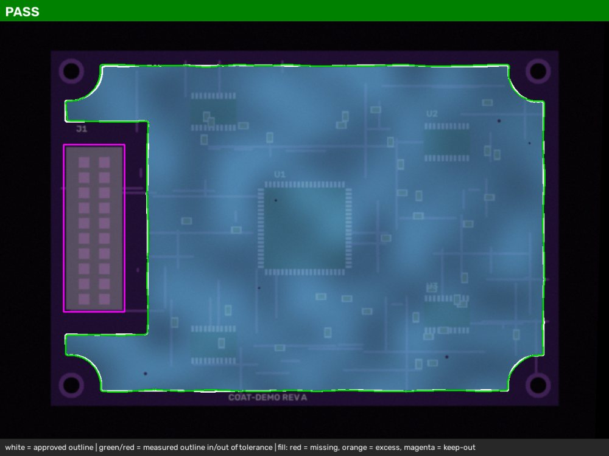 | 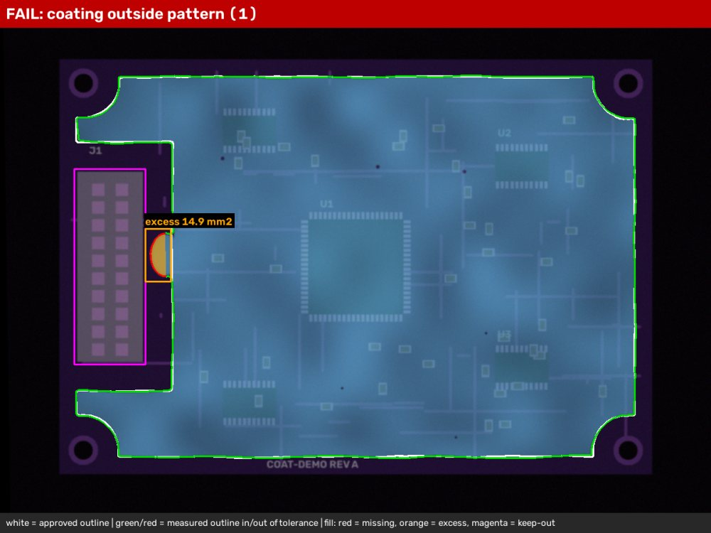 |
| **`keepout_violation`: coating on the connector, filled magenta** | **`shifted_pattern`: missing strips left, excess right, outline red where out of tolerance** |
| 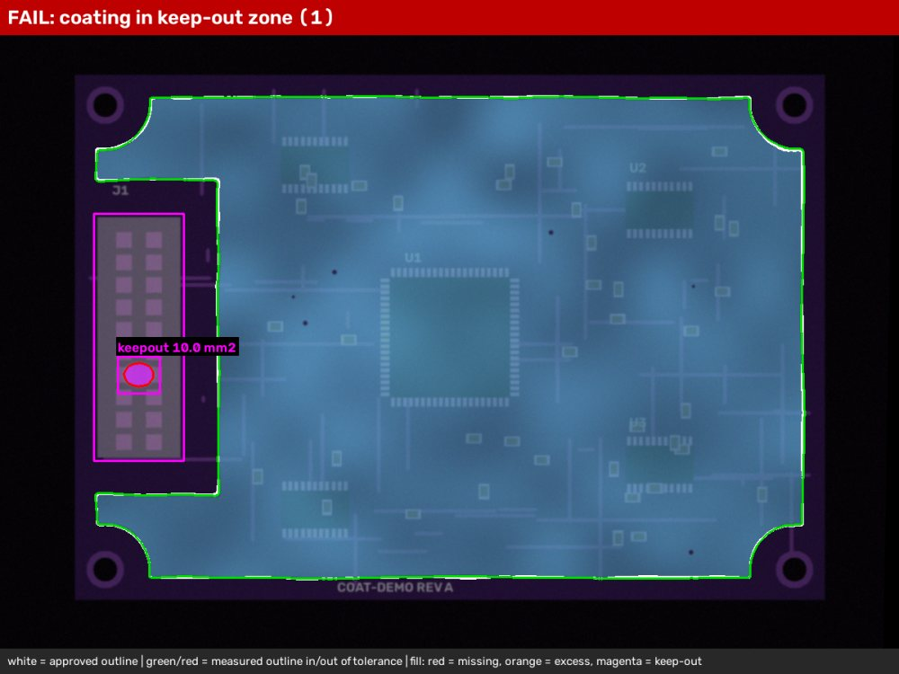 | 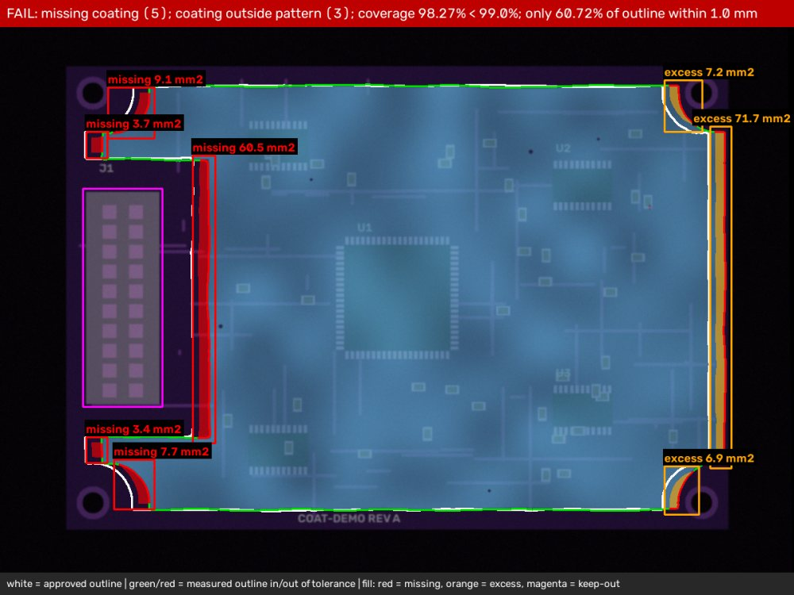 |

For every board, `results/` holds `NAME_result.png`, `NAME_mask.png` and `NAME.json`, and `summary.csv` lists all boards. The JSON report for the missing-coating board:

**`results/missing_coating.json`**

```json
{
  "image": "samples/test/missing_coating.png",
  "result": "FAIL",
  "reasons": [
    "missing coating (1)"
  ],
  "metrics": {
    "coverage_pct": 99.41,
    "outline_match_pct": 97.27,
    "edge_deviation_p95_mm": 0.3,
    "edge_deviation_max_mm": 21.645,
    "iou": 0.9864,
    "coated_area_mm2": 5193.8,
    "golden_area_mm2": 5209.0
  },
  "defects": [
    {
      "kind": "missing",
      "area_mm2": 28.8,
      "box": [
        712,
        297,
        79,
        48
      ]
    }
  ],
  "alignment": {
    "inliers": 294,
    "shift_px": [
      8.0,
      14.01
    ],
    "rotation_deg": 0.514
  }
}
```

`edge_deviation_max_mm` is large here because the skipped area has its own edge, far from any approved edge.

## Step 10: Automated tests

The tests make fresh sample photos in a temporary folder, build a golden pattern, and check that alignment finds each board's known placement and that every board gets the right verdict. Run them after every change.

**File: `tests/test_inspector.py`** (112 lines)

```python
"""Automated checks.  Run:  python -m pytest   (or use the Testing panel in VS Code)

pytest runs every function whose name starts with test_. A test passes when all of
its assert statements are true."""
from pathlib import Path  # handles file and folder paths

import numpy as np  # NumPy: builds a small test picture
import pytest  # the test runner: fixtures, parametrize, approx

from coating_inspector.align import align_to_reference  # the functions being tested ...
from coating_inspector.common import load_config, read_image, write_image  # settings and image files
from coating_inspector.compare import inspect_image  # inspects one photo
from coating_inspector.golden import build_golden, read_keepout  # builds the pattern, reads keep-out zones
from coating_inspector.synthetic import SAMPLES, make_samples  # sample photos and their known placement
from coating_inspector.tune import save_to_config  # the tuner's save function

ROOT = Path(__file__).resolve().parents[1]  # the project folder (one level above tests/)
CFG = load_config(ROOT / "config.yaml")  # the real settings, so the tests check what you will use


# A fixture: made once for this file and handed to every test that names it as an argument.
@pytest.fixture(scope="module")
def samples(tmp_path_factory):
    """Make fresh sample photos once, in a temporary folder, for all the tests in this file."""
    # tmp_path_factory gives a new empty temporary folder; make_samples fills it and returns it.
    return make_samples(tmp_path_factory.mktemp("samples"))


# A fixture: made once for this file and handed to every test that names it as an argument.
@pytest.fixture(scope="module")
def golden(samples, tmp_path_factory):
    """Build a golden pattern once, from the approved sample photos (uses the samples fixture)."""
    # The approved photos, sorted so approved_1 (placed exactly) becomes the reference.
    approved = sorted((samples / "approved").glob("*.png"))
    # Build the pattern with the real settings and the keep-out mask, in another temporary folder.
    return build_golden(approved, CFG, tmp_path_factory.mktemp("golden"), samples / "keepout_mask.png")


def photo(samples, name):
    """Read one sample photo by name, for example photo(samples, "good_1")."""
    # Each sample's folder (approved or test) is stored in SAMPLES.
    return read_image(samples / SAMPLES[name].folder / f"{name}.png")


# Run the next test four times, once for each photo name.
@pytest.mark.parametrize("name", ["approved_2", "good_1", "good_2", "shifted_pattern"])
def test_alignment_finds_the_known_placement(samples, name):
    """Alignment must find each board's true shift (within 1 px) and rotation (within 0.1 degrees)."""
    # Line the photo up with approved_1, which was placed exactly.
    a = align_to_reference(photo(samples, "approved_1"), photo(samples, name), CFG["alignment"])
    # pytest.approx allows a small difference: abs=1.0 means within 1 px.
    assert a.shift_px == pytest.approx(SAMPLES[name].shift, abs=1.0)
    # And the rotation must be within 0.1 degrees.
    assert a.rotation_deg == pytest.approx(SAMPLES[name].angle, abs=0.1)


# Run the next test once for each (photo, expected defect kinds) pair.
@pytest.mark.parametrize("name, expected", [
    ("good_1", set()),                          # no defects: should PASS
    ("good_2", set()),                          # no defects: should PASS
    ("missing_coating", {"missing"}),           # exactly one kind: missing
    ("excess_spill", {"excess"}),               # exactly one kind: excess
    ("keepout_violation", {"keepout"}),         # exactly one kind: keep-out
    ("shifted_pattern", {"missing", "excess"}), # both missing and excess strips
])
def test_boards_get_the_right_verdict(samples, golden, name, expected):
    """Each sample board must get exactly the defect kinds it was made with, and PASS only if it has none."""
    # Inspect the photo and keep the comparison result.
    result = inspect_image(photo(samples, name), golden, CFG).comparison
    # The kinds of defect found must equal the expected set (if not, the reasons are shown).
    assert {d.kind for d in result.defects} == expected, result.reasons
    # PASS exactly when nothing was expected.
    assert result.passed == (not expected), result.reasons


def test_shifted_pattern_fails_the_outline_check(samples, golden):
    """A pattern shifted by 2.5 mm must also fail the outline-match rule."""
    # Inspect the shifted board.
    result = inspect_image(photo(samples, "shifted_pattern"), golden, CFG).comparison
    # Its outline match must be below the minimum in config.yaml.
    assert result.metrics["outline_match_pct"] < CFG["tolerance"]["min_outline_match_pct"]


def test_keepout_can_be_painted_in_magenta(tmp_path):
    """A keep-out zone painted pure magenta on a picture must be read as a mask."""
    # A small black picture (50 x 80 px) ...
    picture = np.zeros((50, 80, 3), np.uint8)
    # ... with a 10 x 30 px magenta rectangle (BGR 255, 0, 255).
    picture[10:20, 30:60] = (255, 0, 255)
    # Save it in pytest's temporary folder.
    write_image(tmp_path / "painted.png", picture)
    # Read it back as keep-out zones.
    keepout = read_keepout(tmp_path / "painted.png")
    # Inside the rectangle = 255, outside = 0, and exactly 10 x 30 = 300 pixels marked.
    assert keepout[15, 40] == 255 and keepout[30, 10] == 0 and (keepout > 0).sum() == 300


def test_tuner_saves_values_and_keeps_comments(tmp_path):
    """Saving from the tuner must change the values in config.yaml and keep its comments."""
    # Copy the real config.yaml to a temporary file, so the real one is not changed.
    config_file = tmp_path / "config.yaml"
    # Fill it with the real file's text.
    config_file.write_text((ROOT / "config.yaml").read_text(encoding="utf-8"), encoding="utf-8")
    # The current settings with two values changed.
    seg = dict(CFG["segmentation"], hsv_lower=[90, 70, 100], close_px=6)
    # Save them the way the tuner does.
    save_to_config(config_file, seg)
    # Read the file back: the new values must be there ...
    saved = load_config(config_file)["segmentation"]
    assert saved["hsv_lower"] == [90, 70, 100] and saved["close_px"] == 6  # both changed values must be saved
    # ... and a comment from the original file must still be there.
    assert "Tune it for YOUR camera" in config_file.read_text(encoding="utf-8")
```

```shell
python -m pytest
```

**Expected output**

```text
collected 13 items

tests/test_inspector.py .............                                    [100%]

============================== 13 passed in 3.97s ==============================
```

The time differs from machine to machine. After step 11, the Testing panel (flask icon) runs the same tests with a click.

## Step 11: Run and debug from VS Code

**File: `.vscode/launch.json`** (39 lines)

```jsonc
{
  // Run and Debug entries for each step: open Run and Debug (Ctrl+Shift+D), pick one, press F5.
  // VS Code allows comments like these in its settings files.
  "version": "0.2.0",  // the format version of this file; VS Code expects 0.2.0
  "configurations": [  // the list of entries
    {
      "name": "1 Make sample photos",  // the name shown in the Run and Debug list
      "type": "debugpy",  // run it with the Python Debugger extension
      "request": "launch",  // start the program (rather than attach to one that is already running)
      "module": "coating_inspector.synthetic",  // the same as typing: python -m coating_inspector.synthetic
      "cwd": "${workspaceFolder}"  // run from the project folder, so config.yaml and samples/ are found
    },
    {
      "name": "2 Tune colours",  // opens the slider windows on the first sample photo
      "type": "debugpy",  // Python Debugger
      "request": "launch",  // start the program
      "module": "coating_inspector.tune",  // python -m coating_inspector.tune
      "args": ["--image", "samples/approved/approved_1.png"],  // the options typed after the command
      "cwd": "${workspaceFolder}"  // run from the project folder
    },
    {
      "name": "3 Build golden pattern",  // builds golden/ from the approved sample photos
      "type": "debugpy",  // Python Debugger
      "request": "launch",  // start the program
      "module": "coating_inspector.golden",  // python -m coating_inspector.golden
      // the options typed after the command:
      "args": ["--images", "samples/approved", "--keepout", "samples/keepout_mask.png", "--out", "golden"],
      "cwd": "${workspaceFolder}"  // run from the project folder
    },
    {
      "name": "4 Check boards",  // checks the test sample photos against golden/
      "type": "debugpy",  // Python Debugger
      "request": "launch",  // start the program
      "module": "coating_inspector.check",  // python -m coating_inspector.check
      "args": ["--golden", "golden", "--images", "samples/test", "--out", "results"],  // the options
      "cwd": "${workspaceFolder}"  // run from the project folder
    }
  ]
}
```

**File: `.vscode/settings.json`** (6 lines)

```jsonc
{
  // Settings for this project folder only. VS Code allows comments like these in its settings files.
  "python.testing.pytestEnabled": true,  // show the tests in the Testing panel (flask icon), run by pytest
  "python.testing.unittestEnabled": false,  // don't use Python's other test runner, unittest
  "python.testing.pytestArgs": ["tests"]  // look for tests in the tests/ folder
}
```

Run and Debug (<kbd>Ctrl</kbd>+<kbd>Shift</kbd>+<kbd>D</kbd>) now lists the four steps. Pick one and press <kbd>F5</kbd>.

### Watch the code run, line by line

1. Open `coating_inspector/compare.py` and click left of the line number of `ppm = tol["pixels_per_mm"]`, the first line inside `compare_masks`. A red dot marks the breakpoint.
2. Choose *4 Check boards* in Run and Debug and press <kbd>F5</kbd>. The program stops at the red dot when it compares the first board.
3. Press <kbd>F10</kbd> to run the highlighted line and move to the next one. Read each line's comment, then watch the Variables panel: `band` becomes 10 (1.0 mm at 10 px/mm), `test` and `golden` become True/False arrays, and so on.
4. Press <kbd>F11</kbd> to step into a function of this project, <kbd>Shift</kbd>+<kbd>F11</kbd> to step back out, and <kbd>F5</kbd> to run on to the next stop.

> **Don't use the ▷ Run Python File button** on these modules. They import each other as a package, so they must run with `python -m` or through these configurations.

## Step 12: Use it on your own boards

### 1. Set up the inspection station

- **Light:** a UV source that matches your coating's tracer. Check the coating datasheet: most UV-trace coatings are inspected at 365 nm, and many also respond to 395–405 nm. Two lamps from opposite sides give more even light than one.
- **Darkness:** an enclosure or hood, so room light doesn't change the picture.
- **Camera:** fixed above the board, square to it and in focus. Turn off auto exposure, auto gain and auto white balance, and keep the same settings for every photo. Save PNG or TIFF, not JPEG.
- **Fixture:** locating pins or corner stops, so every board sits in nearly the same place. The tool corrects small shifts and rotations, not a board half out of the frame.
- **Optional filter:** a long-pass filter (about 420–450 nm) on the lens blocks reflected UV and makes the coating stand out. Keep some board detail visible for alignment.
- **Safety:** UV-A light can harm eyes and skin. Wear UV-blocking glasses and keep the light inside the enclosure.

### 2. Take photos

Photograph 3–5 boards that QA has approved and, if you have them, a few known-bad boards. Put them in folders such as `photos/approved` and `photos/test`. The approved photo whose name sorts first becomes the reference, so give your best-placed board that name.

### 3. Measure pixels per mm

Open the tuner on one photo and click two points a known distance apart, such as two mounting-hole centres 92.0 mm apart on the drawing. The terminal prints the distance in pixels. Divide: `pixels_per_mm` = pixels ÷ mm (for example 1472 px ÷ 92.0 mm = 16.0). Enter the result in `config.yaml`.

### 4. Tune the colour range

```shell
python -m coating_inspector.tune --image photos/approved/board_01.png
```

Click coating (including thin edges and the dimmest corner) and bare board to read their HSV values. Set the sliders so all coating is green and nothing else is, press <kbd>s</kbd>, then check a second photo. With a monochrome camera, set S min to 0 and H to 0–179 so only brightness counts.

### 5. Build the golden pattern and keep-out zones

```shell
python -m coating_inspector.golden --images photos/approved --out golden
```

Check `golden/preview.png`. To mark keep-out zones (connectors, test points, switches, mating surfaces), open `golden/reference.png` in Paint or any editor, paint the zones pure magenta (red 255, green 0, blue 255), save it as a PNG such as `keepout_painted.png`, and build again:

```shell
python -m coating_inspector.golden --images photos/approved --keepout keepout_painted.png --out golden
```

### 6. Set the tolerances

Take the numbers from your coating drawing, customer specification or IPC-A-610 class: `border_mm` (allowed edge wander), `min_defect_mm2` (smallest missing or extra area that counts), `keepout_min_mm2`, `min_coverage_pct` and `min_outline_match_pct`.

### 7. Validate before you rely on it

- **All approved boards must pass.** Check them against their own golden pattern. Their `edge_deviation_p95_mm` values show how far your process's edge normally wanders; set `border_mm` comfortably above that.

  ```shell
  python -m coating_inspector.check --golden golden --images photos/approved --out results/approved
  ```

- **Known-bad boards must fail for the right reason.** Look at each result picture.
- **Repeatability:** remove and re-photograph the same good board ten times. The verdict must not change.

### 8. Daily use

```shell
python -m coating_inspector.check --golden golden --images photos/today --out results/today
```

The exit code is 0 when every board passes and 1 otherwise, and `results/today/summary.csv` keeps the record.

## Troubleshooting

| Problem | Fix |
|---|---|
| `No module named 'cv2'` | The virtual environment is off, or VS Code uses another Python. Select the `.venv` interpreter (<kbd>Ctrl</kbd>+<kbd>Shift</kbd>+<kbd>P</kbd> → *Python: Select Interpreter*) and open a new terminal. |
| PowerShell: "running scripts is disabled on this system" | Run `Set-ExecutionPolicy -Scope CurrentUser RemoteSigned` once, then open a new terminal. |
| `attempted relative import with no known parent package` | The file was started with ▷ Run Python File. Use `python -m coating_inspector.…` from the project folder, or <kbd>F5</kbd> with the step 11 configurations. |
| `No module named 'coating_inspector'` or `config.yaml not found` | The terminal is not in the project folder. Open the project folder itself in VS Code, or `cd` into it. |
| The tuner stops with "The function is not implemented" | The headless OpenCV package is installed. Run `pip uninstall -y opencv-python-headless opencv-python`, then `pip install opencv-python`. |
| `AlignmentError: only … matching features` | The photo is too dark or blurred, shows a different board, or shows only glowing coating. Improve the light and focus, add a little white light, or use a precise fixture with `method: none`. |
| Coating looks patchy in the tuner | Lower V min or S min, raise *close*, and make the lighting more even. |
| Parts or reflections turn green | Raise S min or V min, narrow the H range, or raise *open* or `min_area_px`. |
| Good boards fail on the outline | `border_mm` is tighter than your process, or `pixels_per_mm` is wrong. Compare with the approved boards' `edge_deviation_p95_mm`. |

## Going further

### A trained model for hard cases

The colour range works when the coating glows clearly under controlled light. If it struggles (a weak tracer, strong reflections, many board types), replace only `segment_coating()` with a segmentation model. Alignment, the golden pattern, the comparison and the reports stay as they are.

1. Collect 50–200 photos. Use this tool's masks (`results/*_mask.png`) as first labels and correct them in an annotation tool such as CVAT or Label Studio.
2. Train a U-Net on photo and mask pairs, for example with the `segmentation-models-pytorch` package.
3. Export the model to ONNX, load it with `onnxruntime` inside `segment_coating()`, and return a 0/255 mask the size of the photo.

### Defects inside the coating

Bubbles, cracks, de-wetting and orange peel are about texture rather than the outline. Anomaly detection trained only on good boards, such as PatchCore in the `anomalib` library, is the usual next tool.

### Capture straight from the camera

Grab frames with your camera's Python SDK (for example Basler pypylon, Teledyne FLIR PySpin or IDS peak) or `cv2.VideoCapture`, save each one as a PNG, and call `check.main(["--golden", "golden", "--images", path])`.
